# russh-bbs

**A next-generation BBS you reach over `ssh`, built in Rust with [ratatui](https://ratatui.rs).**
Forums, chat, mail, community pages and five original door games, in a themeable terminal UI. No client to install: if you can `ssh`, you can call the board.

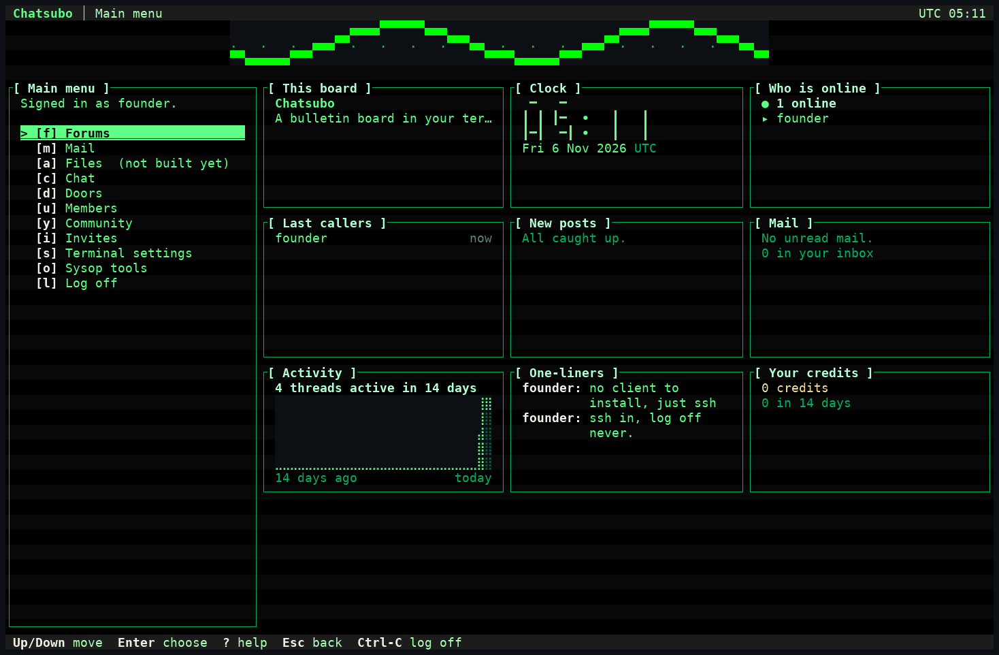

*The dashboard home, Phosphor style, 132x43. Every screenshot in this file was captured from the real server over a real OpenSSH client (see [How the screenshots were made](docs/readme/README.md)).*

Built on the [`russh`](https://crates.io/crates/russh) crate. This project is not affiliated with or endorsed by the russh project.

> **Status:** under active development, pre-release. Milestones M0 to M3.5 are merged and QA-gated, and M4 (files and door games) is partly done: the five door games are playable, file areas are not built yet. There is no tagged release and no published image yet; build from source. [Roadmap](#roadmap) lists what is planned and not built.

## Contents

- [Try it in 60 seconds](#try-it-in-60-seconds)
- [Gallery](#gallery)
- [Feature tour](#feature-tour)
- [Run your own board](#run-your-own-board)
- [Privacy, honestly](#privacy-honestly)
- [Architecture](#architecture)
- [Roadmap](#roadmap)
- [Documentation](#documentation)
- [Contributing](#contributing)
- [Software name vs. board name](#software-name-vs-board-name)
- [License](#license)

## Try it in 60 seconds

You need a Rust toolchain and an OpenSSH client. Nothing is published yet, so build from a checkout:

```bash
git clone https://github.com/pdxgeek/russh-bbs && cd russh-bbs
cargo build --release -p russh-bbs-server
./target/release/russh-bbs-server --listen 127.0.0.1:2222
```

On first start the server prints a one-time **setup token** to the console, between marked lines. In a second terminal:

```bash
ssh -p 2222 claim@localhost     # paste the token, choose a password: you are now the sysop
ssh -p 2222 founder@localhost   # sign in as the founder (the key you claimed with, or your password)
ssh -p 2222 new@localhost       # what a stranger sees: the waiting room
```

State (SQLite database, host key, mail key) goes under `~/.local/share/russh-bbs/`. The board is **invite-only by default**: a stranger's key reaches only a waiting room where it can request or redeem an invite. The first screen asks whether your terminal shows icons; answer honestly and the board picks the right glyph tier (Nerd Font, Unicode or plain ASCII).

Try `Ctrl-K` for the command palette, `d` for Doors, and `s` for Terminal settings to change style and layout.

## Gallery

### One board, many looks

Six complete styles (Phosphor, Amber Terminal, Neon Night, Paper, Deep Space, Classic ANSI), each with its own palette, borders, title treatment and original art, combined with any of seven layouts. Same board, same data, three styles of the dashboard layout:

| Phosphor | Neon Night | Paper |
|---|---|---|
|  | 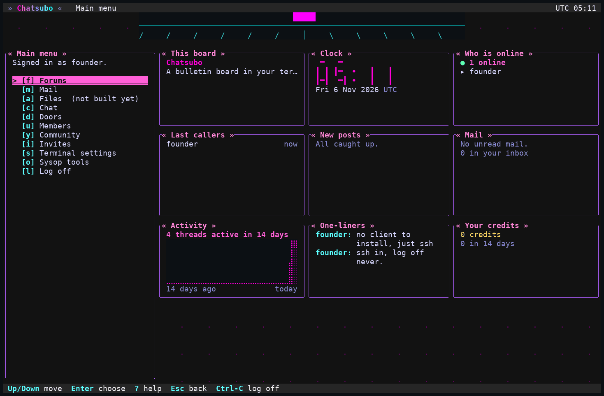 | 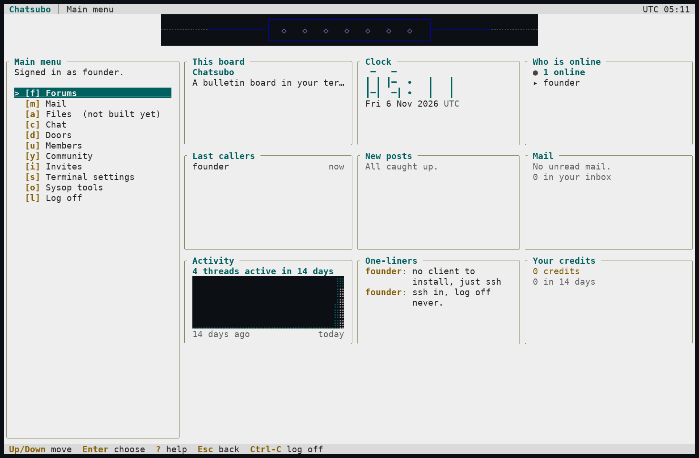 |

### Forums, chat and the command palette

| Forum threads | Forum reader |
|---|---|
| 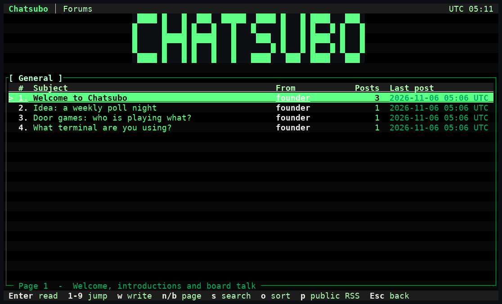 | 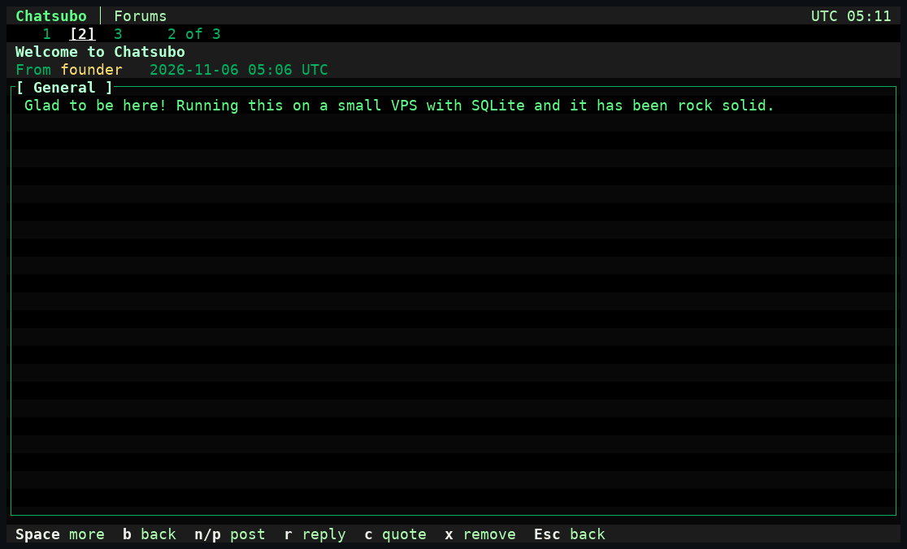 |

**Three-pane chat**: rooms, the conversation, and who is here.

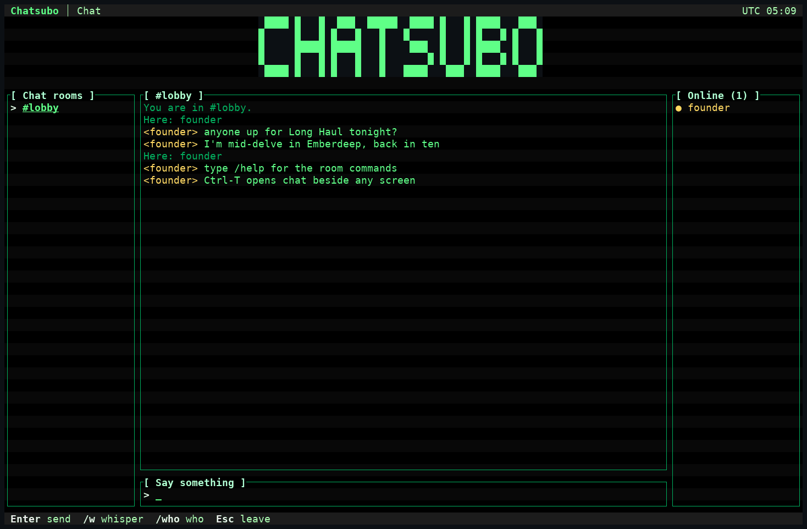

**`Ctrl-K` command palette**: fuzzy search over only what your account can reach.

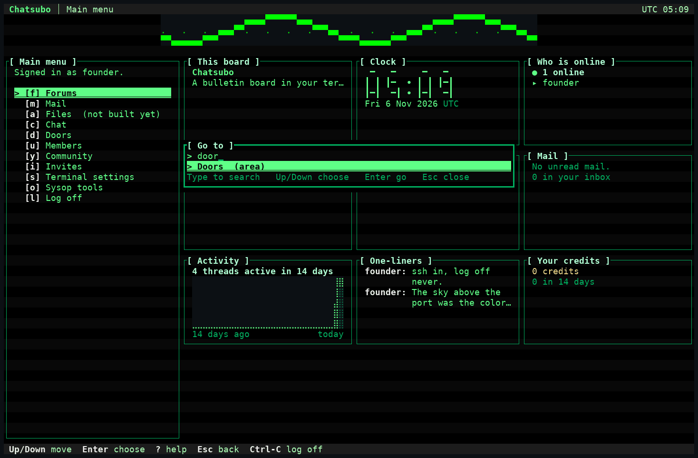

### Door games

Five original games, each with its own world and systems, drawn with full ratatui widgets and cleaned cell by cell before they reach your terminal.

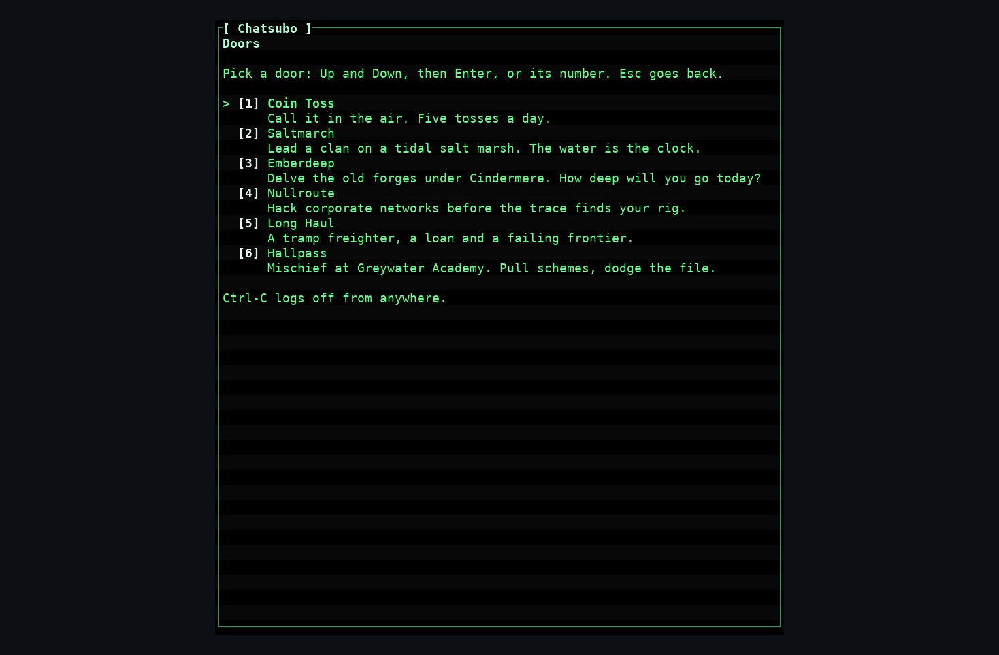

| Long Haul | Nullroute |
|---|---|
| 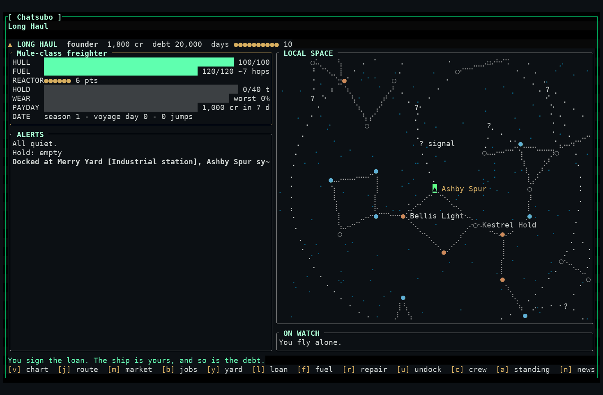 | 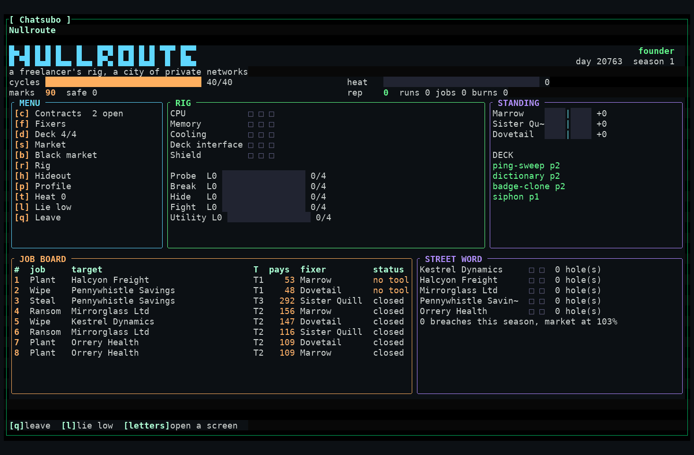 |
| **Emberdeep** | **Hallpass** |
| 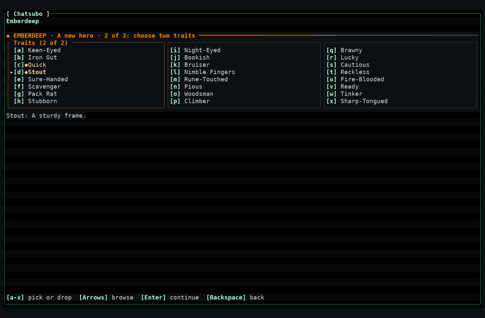 | 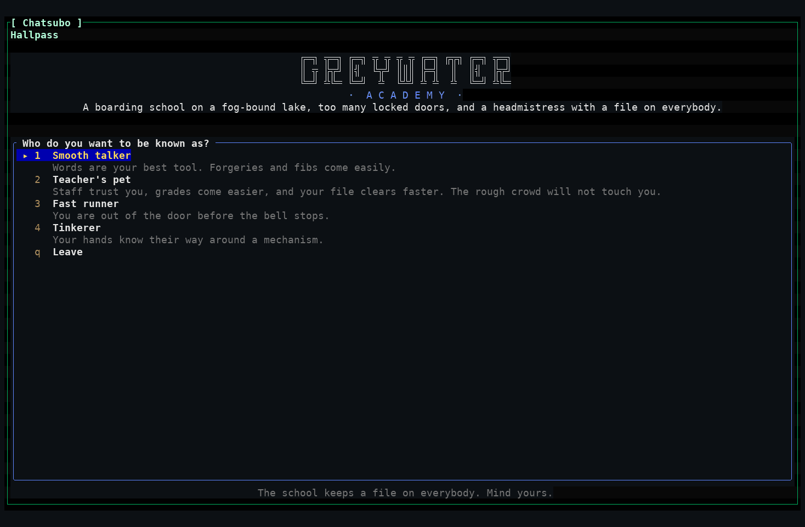 |

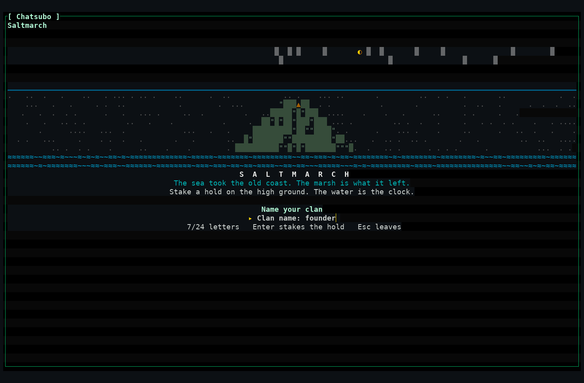

## Feature tour

Everything below is **merged and available** unless it says otherwise. Per-feature status (Implemented or Verified, and what was and was not exercised) is in [docs/features.md](docs/features.md); anything not built yet is in the [Roadmap](#roadmap).

### Forums
- Boards and threads, a full-screen message editor, replies and quoting, search across boards.
- Long lists scroll; every list is sortable.
- RSS **in** (a feed can be a board) and RSS **out** (a board can publish a public feed).

### Mail
- Internal member-to-member mail with a message editor, reply and quote, a report-to-staff button, and per-day and per-mailbox limits.
- Subject and body are **encrypted at rest** and no screen, permission or export lets staff read another member's mail. It is not end-to-end encrypted; see [Privacy, honestly](#privacy-honestly).

### Chat
- Public rooms with presence, whispers and a three-pane layout. `Ctrl-T` opens chat beside any screen, with a draggable divider.
- Room lines live only in a bounded in-memory hub; they are not stored.

### Community
- One-liners, a graffiti wall, last callers, and polls with voting booths.
- Members list and profiles; every profile field is sanitized.

### Accounts, invites and access
- Invite codes (single-use, expiring, stored hashed), per-role quotas and an invite tree.
- Registration modes `invite` (default), `apply` and `open`; the waiting room reveals nothing about members, boards or stats to an unauthenticated key in any mode.
- A sysop queue to approve, deny and vouch.
- SSH keys: list, add, remove, link a new device with a code, staff recovery codes. Password login over SSH is on by default and can be turned off.
- Roles are sets of named permissions, with groups, per-area policies and per-role limits (time, calls, sessions). Every action goes through one access function. There is no screen yet to assign a role or suspend an account; that is an M5 console item.
- An append-only audit log.

### Look and feel
- **Styles:** six complete style packs, plus `default`, `green` and `contrast` themes. Members choose; the sysop can lock a style.
- **Layouts:** classic, lightbar, compact, dashboard, wide, focus and split. Any style with any layout; layouts fall back sensibly on small terminals.
- **Widgets:** 17 dashboard widgets (identity, clock, who is online, last callers, new posts, mail, chat, activity chart, credits, one-liners, wall, poll, news, message of the day, quote, doors, status). Members switch them on and off and reorder them within the sysop's limits.
- **Effects:** an animated login intro, fades, wipes, dissolves, typewriter reveal and glow. Effects respect a per-session cost budget, back off on slow links, and turn off with motion off.
- **Art packs:** `.ans` (CP437) board art, `.art.toml` art slots and a large-letter fallback. The `.ans` parser never passes escape sequences through. Theme packs export and import as one file.
- **Interaction:** mouse (click, scroll, drag), `Ctrl-K` palette, toasts, a live header ticker. Everything also works from the keyboard alone.
- Three icon tiers (Nerd Font, Unicode, ASCII) and colour-depth fallback from truecolor to 16 colours.

### Door games
Six doors are registered: a tiny example (Coin Toss) and the five original games.

| Game | Genre | State |
|---|---|---|
| **Saltmarch** | Clan strategy on a tidal salt marsh | Engine, expeditions, combat, screens and raids/trade are built |
| **Emberdeep** | Fantasy delving RPG | Engine, town and crafting, screens are built; parties, rescues and duels are planned |
| **Nullroute** | Hacking and heists | Engine, countermeasures, coding and screens are built; crews and bounties are planned |
| **Long Haul** | Space trade and exploration | Engine, crew, events, combat and screens are built; convoys and outposts are planned |
| **Hallpass** | School mischief | Engine, classes and clubs, screens and player schemes are built |

Doors run inside the server process behind a framework that sandboxes what a door can see and sanitizes everything it draws. Design notes: [docs/doors/README.md](docs/doors/README.md). Content and balance passes for each game are still open.

### File areas
**Not built yet.** The Files menu item says so. The blob store that file areas will use (local disk and S3-compatible) exists; file areas, SFTP, scanning and quarantine are on the [Roadmap](#roadmap).

### Telnet access
Telnet can be switched on by the sysop and is **off out of the box**. A telnet session is plaintext, and every telnet screen carries a fixed `UNENCRYPTED` marker. Member password login over telnet needs a second, separate switch.

### Sysop tools
The Sysop tools menu has the invite-request queue, staff recovery codes, a theme preview, theme-pack import and export, and a menus-and-pages editor (reorder, rename and hide built-in menu items, add your own information pages). Board name, tagline, style, layout, art and quotes are configuration. The fuller admin console, audit-log screen and moderation workflow are on the [Roadmap](#roadmap).

## Run your own board

Pick one. The binary route below was run from a clean data directory when this section was written; the container and Postgres routes were **not** run in that environment (no Docker daemon or Postgres server there), so check them against [docs/deploy.md](docs/deploy.md) before you rely on them.

### From source (SQLite)

```bash
cargo build --release -p russh-bbs-server
./target/release/russh-bbs-server            # listens on 0.0.0.0:2222 by default
./target/release/russh-bbs-server --help    # every flag
```

Defaults need no configuration. Settings come from, lowest to highest: built-in defaults, a TOML file, `RUSSH_BBS_*` environment variables, command-line flags. Start from [`config.example.toml`](config.example.toml) and pass it with `--config`; every key is documented in [docs/config.md](docs/config.md). Give the board an identity and a look with environment variables:

```bash
RUSSH_BBS_BOARD_NAME="My Board" \
RUSSH_BBS_BOARD_STYLE=neon \
RUSSH_BBS_BOARD_LAYOUT=dashboard \
./target/release/russh-bbs-server --listen 127.0.0.1:2222
```

Style names are `phosphor`, `amber`, `neon`, `paper`, `deepspace` and `ansi` (plus `default`, `green` and `contrast`). Use `--db` and `--host-key` to put state somewhere else. The mail key (`mail.key`) is *not* moved by those two flags (a known issue, tracked as FIX-DOC1-1 in [docs/coordination.md](docs/coordination.md)): set `mail.key_file` as well, and back up the database, the host key and the mail key together.

Switch telnet on with `RUSSH_BBS_TELNET_ENABLED=true` (port 2323 by default). It stays plaintext.

### Container

```bash
docker build -t russh-bbs .
docker run -d --name bbs -p 2222:2222 -v bbs-data:/data russh-bbs
docker logs bbs                  # the one-time founder token
ssh -p 2222 claim@localhost
```

`compose.yaml` is an example with one service and one volume. **No image is published yet**; the owner decides when to cut a release, so build locally for now. The container is not a sandbox for door games. Details, backups and upgrades: [docs/deploy.md](docs/deploy.md).

### Postgres instead of SQLite

Both backends are built and tested against the same store suite, and the server never falls back from one to the other. Set `RUSSH_BBS_DATASOURCE_KIND=postgres` and `RUSSH_BBS_DATASOURCE_URL=postgres://...`; TLS is required by default. See [docs/config.md](docs/config.md) (`[datasource]`) and the Postgres notes in [docs/deploy.md](docs/deploy.md).

## Privacy, honestly

- In the current version **the server operator can read nearly everything**: posts, chat, files and metadata. SSH protects data in transit, not from the board.
- **Mail is encrypted at rest and no screen or permission lets staff read it**, but that is not end-to-end encryption: someone holding both the database and the mail key file, or able to change the server's code, can read it. Who wrote to whom, and when, is stored in the clear.
- The server cannot read **mail a member PGP-encrypts themselves before sending**, or **files a member encrypts locally before uploading**. Built-in PGP mail is planned, not built.
- True end-to-end encrypted private messaging needs a native client and is a later milestone. Nothing in the UI is labelled private unless the server genuinely cannot read it.

The contract for what this project may claim is [docs/threat-model.md](docs/threat-model.md). All text that is not UI chrome (posts, handles, mail, door output) passes one shared sanitizer, and security markers are drawn in a reserved style in a chrome-only position, never from content.

## Architecture

Business rules live in one core crate. Front ends are thin and call it; the same rule never exists in two places.

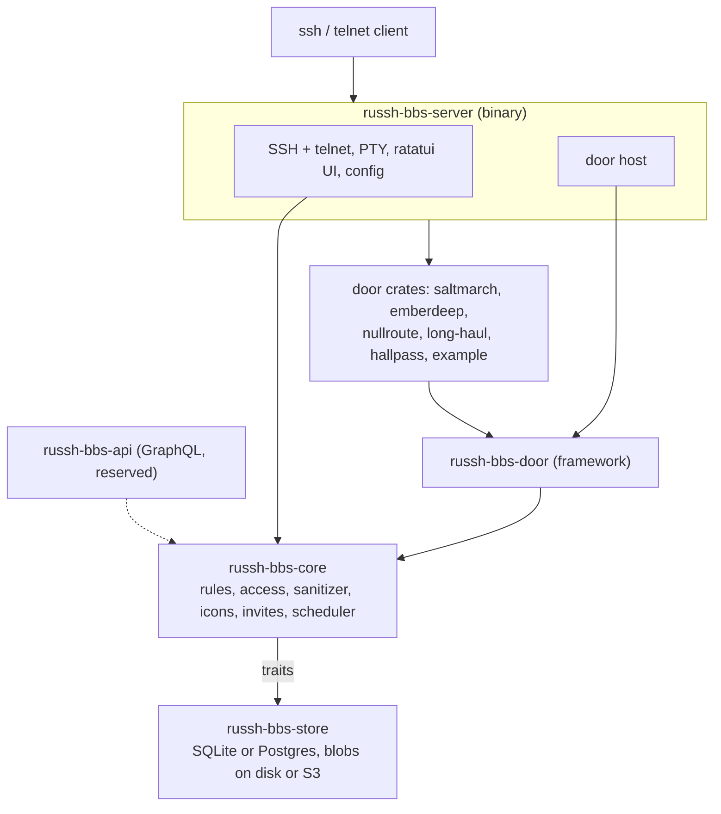

| Crate | Role |
|---|---|
| `crates/core` (`russh-bbs-core`) | Domain types, rules, permissions, the shared sanitizer, icon registry, invites, scheduler. Depends on no other crate here. |
| `crates/store` | SQLite and Postgres implementations of core's storage traits, one forward-only migration set each. |
| `crates/server` | The binary: SSH and telnet front ends, the ratatui UI (styles, layouts, widgets, effects), config, door host. |
| `crates/doors/framework` | The `Door` trait, saves, daily tick, replay and simulation helpers, sandbox rules. |
| `crates/doors/*` | One crate per game, depending on the framework only. |
| `crates/api`, `crates/proto` | Reserved for the GraphQL API and a future native client; empty for now. |

More: [docs/architecture.md](docs/architecture.md) and [docs/ui.md](docs/ui.md).

## Roadmap

**Planned, not built.** Dates are not promised; each milestone starts only when the owner approves it. Status of every row: [docs/features.md](docs/features.md).

- **Rest of M4:** file areas over SFTP with scanning and quarantine, file tagging and batch download, a global "since your last call" scan; content and balance passes for each door (Saltmarch, Emberdeep, Nullroute, Long Haul).
- **M5, sysop tooling and API:** admin TUI, page the sysop and sysop chat, moderation workflow and audit-log screen, notifications and digests, backups with a tested restore on every backend, data export and account deletion, accessibility mode, a read-only GraphQL API.
- **M6:** external mail (inbound, then outbound through a relay) and PGP mail through a local `gpg`.
- **M7:** WASM plugins and menu scripting.
- **M8:** federation, NNTP, finger and an IRCv3 gateway for chat rooms.
- **M9:** a native client with end-to-end encrypted messages.

## Documentation

- [docs/README.md](docs/README.md): the documentation index, by area.
- [Sysop and member guides](docs/guide/): the [sysop guide](docs/guide/sysop/01-install.md) (install, first start, config, people, look and feel, doors, backups, troubleshooting), the [member guide](docs/guide/member/01-connect.md), and [who can read what](docs/guide/privacy.md).
- [docs/vision.md](docs/vision.md), [docs/features.md](docs/features.md), [docs/decisions.md](docs/decisions.md).
- [docs/deploy.md](docs/deploy.md), [docs/config.md](docs/config.md), [docs/threat-model.md](docs/threat-model.md), [docs/ui.md](docs/ui.md), [docs/doors/README.md](docs/doors/README.md).

## Contributing

Start at [AGENTS.md](AGENTS.md): the rules for people and agents, including the product rules that are not negotiable (be honest about privacy, sanitize everything that is not chrome, security cues are not themeable). Then read [docs/README.md](docs/README.md), check [docs/coordination.md](docs/coordination.md) for open work, and claim a slice before starting. Cloud sessions: [docs/cloud-sessions.md](docs/cloud-sessions.md). Work happens on a branch named `<milestone>/<slice>` and goes in through a pull request against `main`.

Run these before every PR and report the results honestly:

```bash
cargo fmt --all --check
cargo clippy --workspace --all-targets -- -D warnings
cargo test --workspace
cargo deny check
```

A passing build does not prove behavior: for anything user-visible, also run the server and exercise it with a real `ssh` client.

## Software name vs. board name

`russh-bbs` is the software. A running board has its own name, chosen by its sysop (candidates for the first board: Chatsubo, Lowtek). See [docs/decisions.md](docs/decisions.md).

## License

Not chosen yet. Do not add a license file without the owner's decision.
