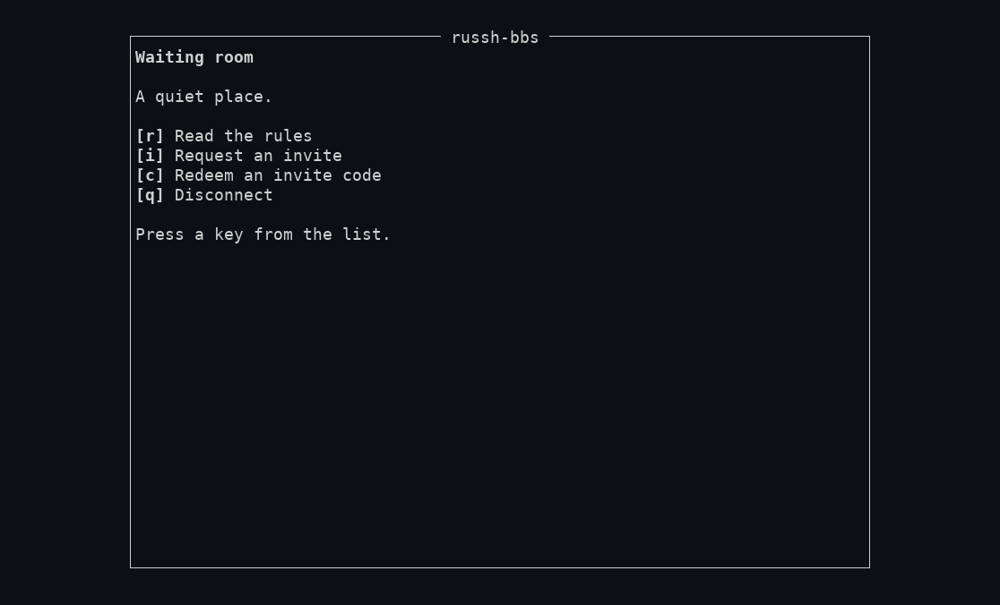
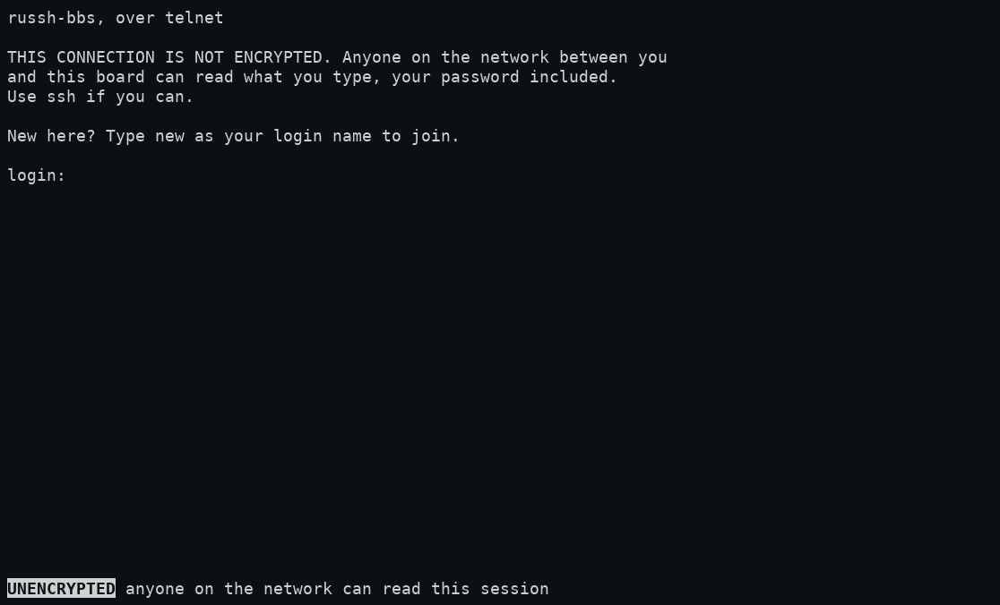
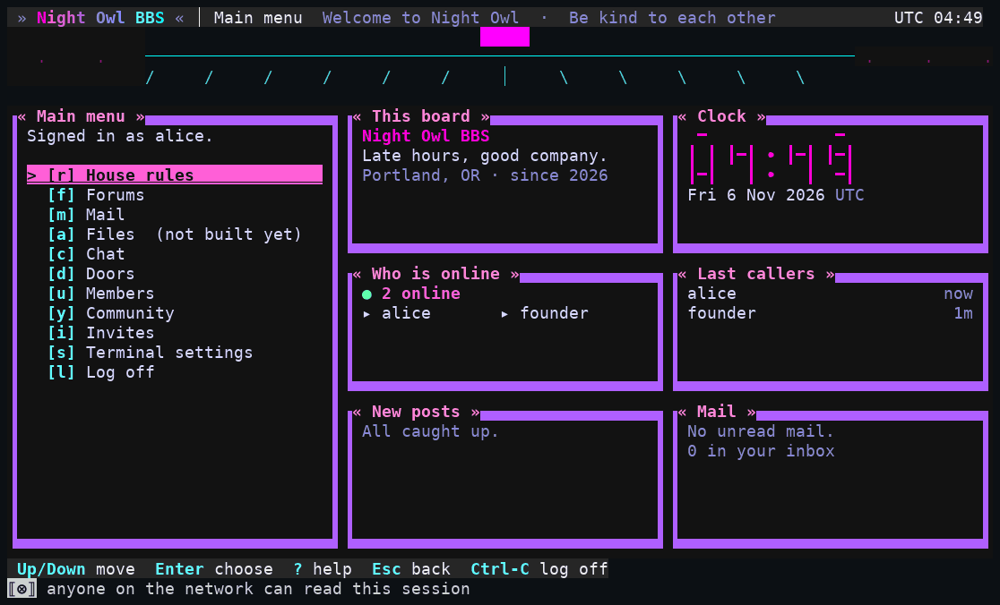

# 1. Connecting and signing in

You need a terminal and `ssh`, which every Mac, Linux and recent Windows machine already has. Your sysop gives you three things: the **address**, the **port** (often `2222`, not the usual 22), and the board's **host-key fingerprint**.

Everything below uses `-p 2222` and `bbs.example.org`; replace them with yours.

## Joining

You need an **invite code** from a member, or you can ask the sysop (depending on how the board is set up: invite, apply, or open sign-up; see "What the waiting room offers"). To join:

```bash
ssh -p 2222 new@bbs.example.org
```

The user name `new` is not an account; it means "I am new here" and opens the **waiting room**. The first time you connect, ssh shows the server's fingerprint. **Compare it with the one the sysop published**, then answer `yes`. If it is different, stop.



Choose **Redeem an invite code**, then type the code, the **handle** you would like, and a **password** (12 to 128 characters, twice). You are in. The key your ssh client used is bound to your new account, so next time you can sign in without typing the password.

> **No ssh key? That is fine.** If your computer offers no key, ssh asks for a password for `new@…`. Just press Enter; nothing you type there is read or stored. (If you have keys but want to join with none: `ssh -p 2222 -o PubkeyAuthentication=no new@bbs.example.org`.) You then have a password-only account, and can add a key later.

**What the waiting room offers** depends on the sysop's setting; in every mode a stranger sees nothing about members or boards, only the banner and rules and these:

| Board mode | You will see |
|---|---|
| `invite` (the default) | Read the rules, **Request an invite** (the sysop may say yes), **Redeem an invite code** |
| `apply` | Read the rules, **Apply for membership** (a sysop approves; nobody is notified, connect again later with the same key) |
| `open` | Read the rules, **Create an account** |

With a key you also see **I already have an account**, **Link this device** and **Recovery code** (below). Over a connection with no key those three are not shown, because they need a key to bind.

## Signing in

```bash
ssh -p 2222 yourhandle@bbs.example.org
```

## The sign-in model

**Your account is a handle and a password. An ssh key is the optional extra** (D94 to D97). You can do either:

1. **With a key.** If the key your ssh client offers is one bound to that handle, you are signed in at once. No password prompt. Keys never wait or get locked out by wrong passwords.
2. **With the password.** If no key matches, ssh asks for your password. This works from any machine, and it is the only way for a key-less account. Wrong passwords back off: the first few are free, then each wrong try costs a longer wait, up to 30 seconds for your handle. Every failure looks the same, whether the handle exists or not.

Walked with real OpenSSH: `ssh alice@…` with the account's key signed in directly; with `-o PubkeyAuthentication=no` it asked for the password, rejected a wrong one and asked again, then accepted the right one. A key bound to a *different* handle does not sign you in; it falls back to the password.

**Changing your password:** Terminal settings (`s` from the main menu), then `s` Password: set or change it (12 to 128 characters). `c` clears it (the screen asks first). Setting or changing it ends your other sessions that signed in with a password.

### Your keys

Members, then **My keys** (`u`, then `k`) lists up to four keys by fingerprint, with when each was added and last used. `a` adds a key (paste the one `ssh-ed25519 AAAA…` line from your `.pub` file; only Ed25519 is accepted, and the board stores only the public fingerprint); `r` removes one; **the last way in is never removed**. When a key is added or removed, you are told at your next sign-in ("A key was added on … Remove it under My keys if this was not you"). Removing a key **closes** any live session that signed in with it.

### A new machine without the password: device links

On a machine that is already signed in: Members, My keys, **`l` Link a new machine**. It shows a code **once**, such as `ABCDE-FGHJK` (an example, not a real code), valid ten minutes and once, at most five an hour. On the **new** machine:

```bash
ssh -p 2222 new@bbs.example.org
# choose  [d] Link this device , type the code
```

Walked: a real code was entered from a different key, and the screen came back **Signed in as alice**. That key is now bound to the account.

(Telnet can make a code but cannot use one; use ssh to redeem it.)

### If you lose your key *and* your password: recovery codes

Ask a sysop. They confirm it is you **outside the board** (a call, a message on a channel you already trust: the board has nothing to check you against), then give you a 16-character code, valid 24 hours, once. On your machine: `ssh new@…`, **`[y]` Recovery code**, enter the code and a **new password twice**. Your connection's key is bound and your old password stops working. Any other session of yours that was open is closed with "Your sign-in was revoked. Please sign in again." Your *older keys are not removed* (the board cannot tell which one was lost); you are told at your next sign-in, and should remove any you do not recognise. A sysop's own account has no recovery code (a second sysop helps).

## Telnet

Some boards switch on telnet; most do not. If yours does, you connect with a plain `telnet` client:

```bash
telnet bbs.example.org 2323
```



Be aware of what it is: **the whole session crosses the network unencrypted**, your password included. Every telnet screen carries a fixed `UNENCRYPTED` marker on its last row that nothing can hide. **Use ssh if you can, and never reuse a password you typed over telnet.**

- Type `new` at `login:` to join: the same waiting room as over ssh, in whatever mode the board uses. You join as a **password account** (there is no key to bind). Passwords can use printable ASCII only.
- Otherwise type your handle and your password.
- Walked: a telnet sign-in as a member, then the same menus as ssh. **Staff powers are dropped over telnet (D94)**: a sysop or co-sysop who signs in over telnet is an ordinary member, with no Sysop tools. There is no SFTP (not built anyway) and no founder claim over telnet.



Next: [your terminal](02-terminal.md).
