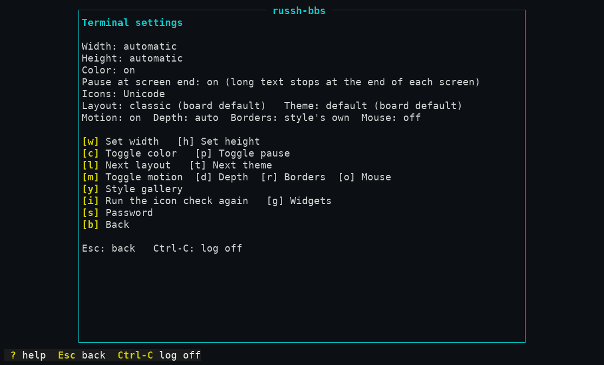
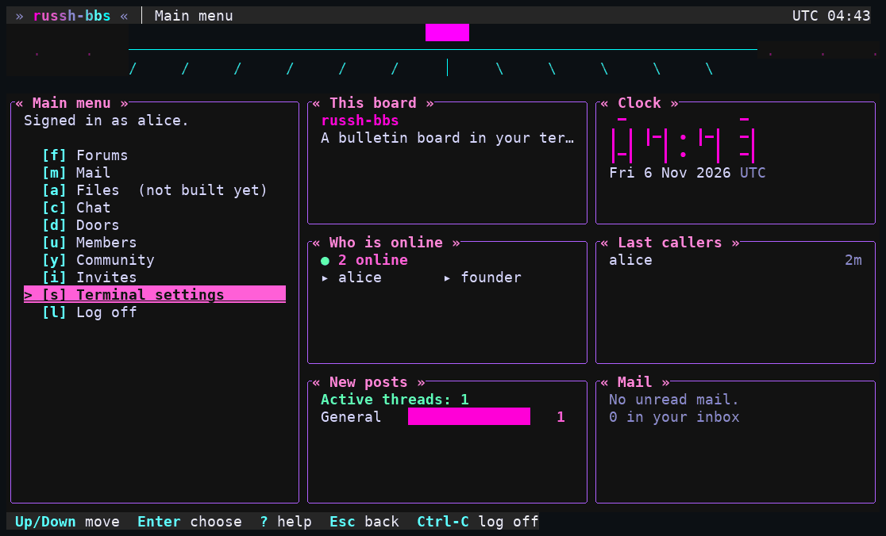
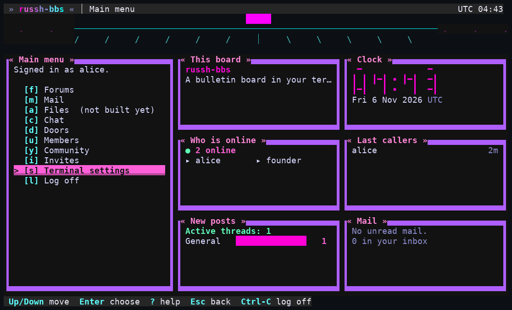

# 2. Your terminal

The board draws with your terminal's help, and the server cannot see your terminal's font. So it asks. Everything on this page is on one screen: from the main menu press **`s` Terminal settings**. Your choices are saved to your account and apply on the next frame.

*Terminal settings as one member had it: layout `dashboard`, motion on, borders set to "blocks".*

| Key | Does |
|---|---|
| `w`, `h` | Set the width or height by hand (blank is automatic). Needed only if your terminal reports the wrong size. If a stored size does not fit and you cannot see the screen, type `s`, `w`, Enter, `h`, Enter to reset it blind |
| `c` | Colour on or off (off draws with weights and underline only) |
| `p` | **Pause at screen end**: long text stops at the end of each screen and waits for a key. Off shows the first screen and says how many lines are left |
| `i` | Run the **icon check** again |
| `l` | Next **layout** |
| `t` | Next **style** (called "Theme" on the screen) |
| `y` | The **style gallery**: browse styles with Up and Down, `s` shows a sample, Enter uses it |
| `m` | **Motion** on or off |
| `d` | Colour **depth** ceiling: auto, 16, 256, truecolor. It can only lower what your terminal says it can do |
| `r` | **Borders**: the style's own, plain ASCII (`+ - |`), or Blocks |
| `o` | **Mouse** on or off |
| `g` | **Widgets** (the small panels on some layouts): [3. Using the board](03-using-the-board.md#widgets) |
| `s` | **Password** |

## The icon check

On your first login, and any time with `i`, the board shows one set of icons and asks **"Do these look like icons?"**: `y` keeps it, `n` tries the next (Nerd Font, then Unicode symbols, then plain ASCII), and `Esc` chooses plain ASCII with no colour. Choose the first one that looks right. Plain ASCII works everywhere. Until you answer, the board draws in plain ASCII with no colour.

## Styles and layouts

A **style** is how everything looks (colours, borders, titles, banner art). A **layout** is how the panes are arranged. They are independent: any style with any layout.

- **Styles** you may see: `default`, `phosphor` (green CRT), `neon`, `paper` (calm and light), `amber`, `deepspace`, `ansi` (a 1994 board), `green`, `contrast`, and any the sysop added. Walked: `t` or the gallery cycles them; the choice was still there at the next sign-in.
- **Layouts:** `classic` (a hotkey menu), `lightbar` (the same with a cursor: Up and Down then Enter), `compact` (one plain column), `dashboard` (menu plus widget panels), `wide`, `focus` (`Tab` opens the widgets) and `split` (menu beside a second pane). If your window is too small for the layout you picked, the board falls back and says so ("Showing Dashboard: this terminal is too small for Wide.").
- The **sysop can lock** either choice (one allowed style or layout means everyone has it). If a key does nothing, that is why; the screen says so.
- Choosing a style never hides the security marker on the last row; no style or setting can.

### Box lines with gaps (Terminal.app)

If the lines of the boxes look broken (a dashed `│` instead of a solid one), your terminal is drawing the line characters from the font with extra line spacing, which is common in macOS **Terminal.app** and some other terminals. The icon check itself tells you, on every step:

> Box lines look broken? Your terminal is drawing them from the font with extra line spacing. Set line spacing to 1.0, or choose the Blocks border style.

Two fixes, either is enough:

1. **Set line spacing to 1.0** in your terminal's profile (in Terminal.app, Settings, Profiles, Text; the sliders are by the font and the exact label depends on your macOS version).
2. **Choose the Blocks border:** Terminal settings, `r` until it says `blocks`. Boxes are then drawn with block characters (`▐ ▌ ▄ ▀`) that fill the whole cell, so they stay solid whatever the spacing.

Honest limits: Blocks affects **boxes only**; the thin rules between panes and in titles can still show gaps. And the screenshots here come from a renderer that draws block characters as filled cells, so they show the *intended* edge; **Terminal.app itself has not been checked** by the people who wrote this.

## Motion, colour and accessibility

- **Motion** (`m`): the animated login intro, the menu transition, the blinking cursor and the header ticker's scrolling. Turn it off if it distracts you or your link is slow (a slow link is detected and effects stop on their own). **The sysop can turn motion off for everyone**, and the `paper` style never animates.
- **Colour** (`c`) off, **depth** (`d`) at 16, and **borders** at ASCII give you a plain, high-contrast screen. The `contrast` style is a high-contrast palette; `ansi` uses only the sixteen named colours.
- **Plain text:** the `compact` layout is a single column with no box, header, or art; with the ASCII icon tier and colour off, everything the board draws is ASCII. It is meant for screen readers and very small windows (the screen-reader part has not been tried).
- **Mouse** (`o`, off by default) lets you click menu rows and table rows and scroll with the wheel. A click does nothing a key does not: it just presses that key for you. Use it only if your terminal reports the mouse; otherwise nothing changes.
- Everything on the board works from the keyboard alone. Universal keys: **`?`** help, **`Esc`** back one step, **`Ctrl-C`** (or `Ctrl-D`) log off from anywhere.

**Not built (M5): an "accessibility mode"** that sets all of this in one switch; the settings above are what exists. **Not verified:** any screen reader, macOS Terminal.app, iTerm2 or Windows Terminal; this guide was written with `tmux` and a pyte-rendered screen.

Next: [using the board](03-using-the-board.md).
