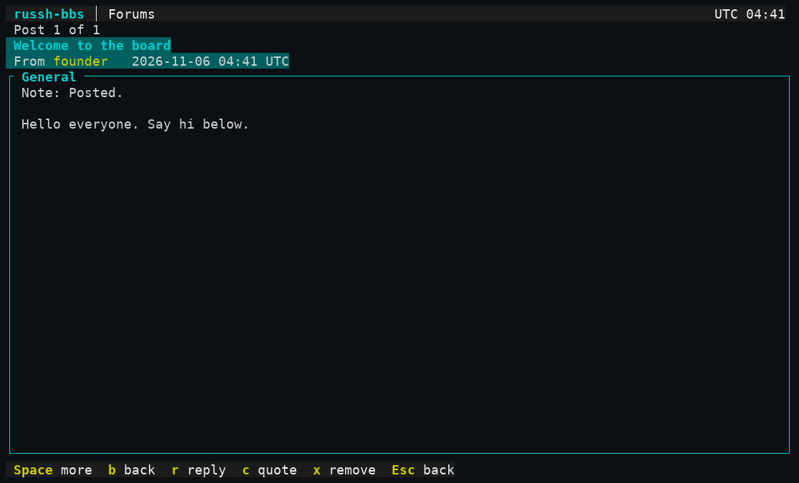
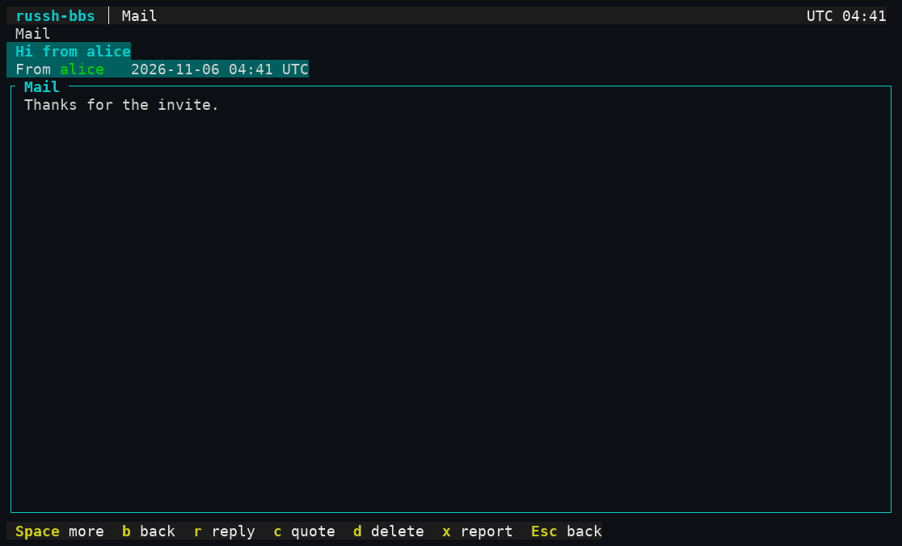
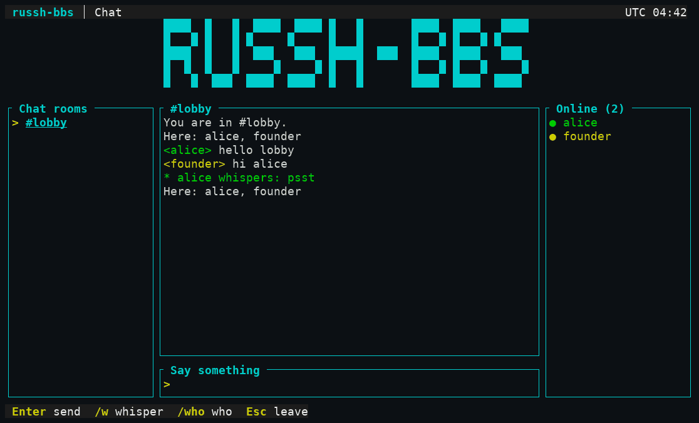
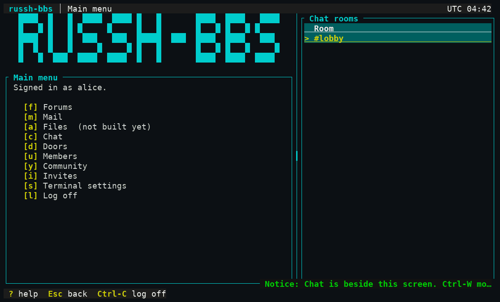
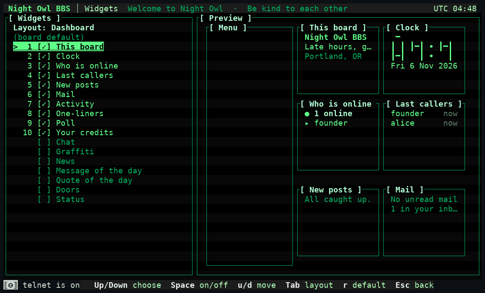
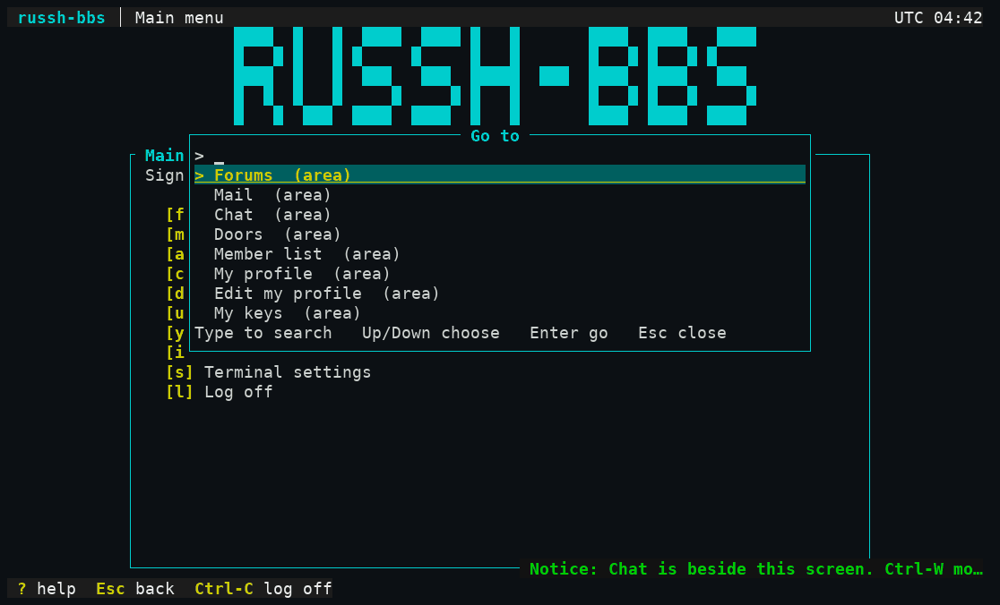

# 3. Using the board

After you sign in you land on the main menu. Press the **letter in brackets** to go somewhere. `Esc` goes back one menu, `?` shows help, `Ctrl-C` logs off. Items you may not use are simply not listed. What the server can read about what you do here is on **one page**, the [privacy page](../privacy.md); it is not repeated below.

The layout you see depends on the board and your own settings ([2. Your terminal](02-terminal.md)). The main menu in the plain `classic` layout:

```
[f] Forums      [m] Mail        [a] Files (not built yet)   [c] Chat
[d] Doors       [u] Members     [y] Community               [i] Invites
[s] Terminal settings           [o] Sysop tools (staff only)  [l] Log off
```

## Forums

`f` lists the boards you may open (a board you cannot reach is not listed). `Enter` or a digit opens one; `s` searches; `o` sorts.



- **In a board's thread list:** `w` writes a new thread (it asks for a subject first, then opens the editor); `n` and `b` page forward and back; `s` searches.
- **The reader** shows one post at a time: `Space` or `Enter` for the next page, `b` back a page, `n`/`p` for the next or previous post, `r` replies, `c` replies quoting the post. Staff also see `x` to remove a post.
- **The editor** is a full-screen text box: type; **`Ctrl-X` sends**; `Esc` leaves (with changes it asks: `s` save draft, `d` discard, `c` keep editing); `Ctrl-G` lists the keys; `Ctrl-Z` and `Ctrl-R` undo and redo. Pasting works. The editor holds at most 16,000 characters (mail: 8,000). **Plain ASCII only today:** other characters are dropped, with a one-line notice.
- A new board starts with none. If you see "There are no boards you can open yet", the sysop has not made one or none is open to you.

## Mail

`m` is your mailbox: newest first, unread marked with `*`. `Enter` or a digit reads; `c` writes (a handle, then a subject, then the editor); in the reader `r` replies and `c` replies with the message quoted; `d` deletes (it asks); `x` reports the message to the staff (it tells you exactly what is copied, and asks, first); `n`/`b` page; `o` sorts.



Walked: one account wrote to another (`Notice: Sent.`), the other opened it. A wrong or inactive handle gets one answer ("No active member has that handle."). Limits: a subject up to 120 characters, a body up to 8,000 characters and 200 lines (refused, not cut), 20 messages a day as a `member`, and a mailbox holds 200 messages; a full mailbox refuses a new message and tells the sender. There is **no sent folder** and no email or push notification; the Mail widget (dashboard layouts) shows what is unread.

**What mail is, once:** stored sealed so a copy of the database does not reveal it, with no staff reader. It is not end-to-end encrypted and the server is the thing that seals and opens it. See the [privacy page](../privacy.md).

## Chat

`c` shows the rooms you may join (a board starts with `#lobby`). `Enter` joins; type and press `Enter` to speak. In a room:

| Type | Does |
|---|---|
| `/w name text` | **Whisper** to someone in this room |
| `/who` | Who is here |
| `/leave` | Back to the room list (`Esc` too) |
| `/help` | The list |



The conversation is not stored: it is in memory while the server runs, and you see only what is said while you are there. Nicknames get a stable colour. Rooms may be open or invite-only, set by the staff.

### Chat beside anything: `Ctrl-T`

From the main menu or most screens (forums, mail, members, community, invites) press **`Ctrl-T`** and chat opens in a second pane **beside** what you are doing. You keep browsing; messages arrive without a key press.



| Key | Does |
|---|---|
| `Ctrl-T` | Open chat beside this screen. Press it again to close the pane (and leave the room) |
| `Ctrl-W` | Move your keys between the screen and the pane |
| `<` `>` | Narrow or widen the pane one column; `{` `}` eight (while the screen has the keys and no text field is open) |
| mouse | With Mouse on: drag the divider; a click on the other side moves the keys there |

You need a window at least 65 columns wide; otherwise you get a notice and no pane. The pane is not drawn on the editor, the settings screens, doors or the Widgets screen; going to one closes it. Only one chat is open at a time. (`Ctrl-T` inside the *editor* is page up, a different key for a different job.)

## Community

`y` opens four small classic features: **`o` One-liners** (up to 70 characters; the newest 15 are shown; 5 an hour), **`g` Graffiti wall** (60 characters, newest 12, 10 an hour), **`l` Last callers** (when each member was last on), and **`p` Polls**. A poll has a question, two to six options and an optional description; one vote per member, cast with its number, and not changeable. Whether you see the counts always, after you vote or after it closes is the poll's own setting. Making a poll needs the `trusted` role. These lists are visible to every member and to the sysop, and votes are recorded with who cast them (members see counts only). Staff can remove lines and polls.

## Members, profiles and invites

- **Members** (`u`): `l` the **member list** (active members only, searchable by handle prefix), `p` **My profile**, `e` **Edit my profile** (display name, pronouns, location, about and a website; plain text only, a website is never opened or made a link; the screen says "The sysop and every member can read this profile."), `v` vouch for an invite request (trusted and up), `k` **My keys** ([1. Connecting](01-connect.md#your-keys)).
- **Invites** (`i`): `c` **Create an invite** (a code shown once; valid seven days, single use; you are recorded as the inviter and your quota is the `member` role's two a month), `y` your invites, `t` the invite tree. Give the code to someone out of band; they redeem it at `ssh new@host`.

## Widgets

In the `dashboard`, `wide`, `focus` and `split` layouts the screen has small live **widget** panels: who is online, new posts, mail, the clock, last callers, one-liners, a poll, the board's message of the day and more. **Terminal settings, `g`** is the Widgets screen:



`Up`/`Down` choose, `Space` switches one on or off, `u`/`d` move it, `Tab` changes which layout you are editing, `r` restores the board's default. A widget the sysop **locks on** cannot be switched off and one locked off cannot be switched on. A widget never shows anything you could not reach by hand: no mail count if you cannot read mail.

## The command palette: `Ctrl-K`

At the main menu or one of its submenus, `Ctrl-K` opens a search box over everything you can reach: type a few letters (they only have to appear in order, so `mem` finds "Member list"), `Up`/`Down` choose, `Enter` goes there, `Esc` closes. Recent choices come first. It lists **only what your account may open** (a staff-only item is simply not there), and choosing an entry presses the same keys you would have, so nothing it does is something you could not do yourself.



Next: [doors](04-doors.md).
