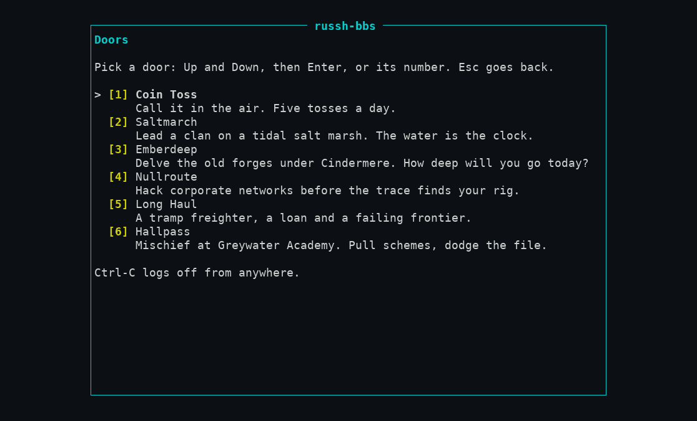
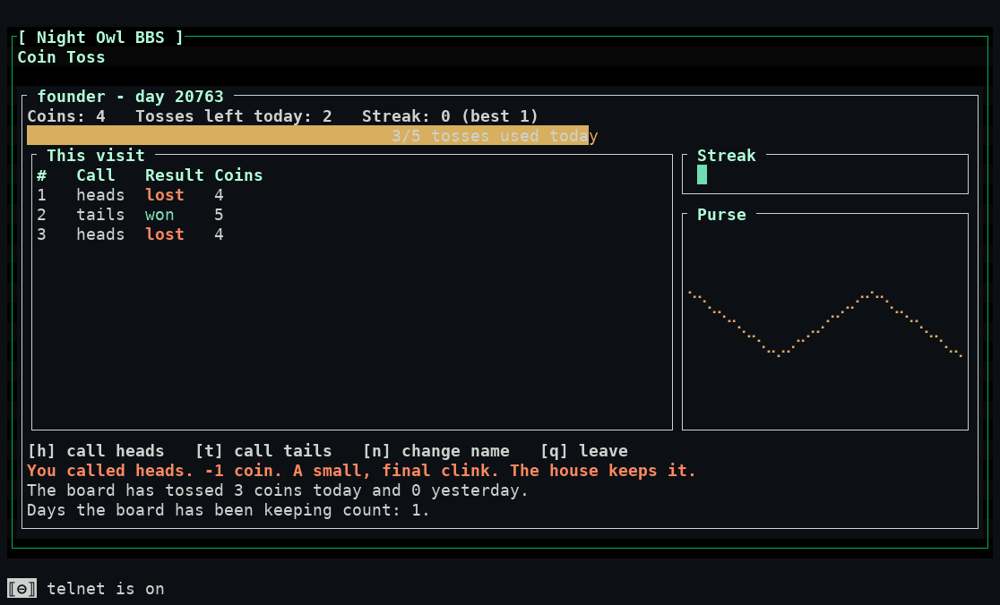

# 4. Doors

**Doors** are the games on the board, a name from old bulletin boards. Press **`d`** on the main menu to see them; press the number of one to play.

Six games are on every board that runs this version:

| # | Game | What you do |
|---|---|---|
| 1 | **Coin toss** | A tiny example game: call heads or tails, five tosses a day, a shared tally |
| 2 | **Saltmarch** | Lead a clan on a tidal salt marsh; the water is the clock. Daily turns |
| 3 | **Emberdeep** | Delve the old forges under Cindermere with one hero. How deep will you go today? |
| 4 | **Nullroute** | Hack corporate networks with a rig you build, before the trace finds you |
| 5 | **Long Haul** | A tramp freighter, a loan and a failing frontier |
| 6 | **Hallpass** | Mischief at Greywater Academy: pull schemes, dodge the headmistress's file |

Each is an original game with its own rules, and each opens with its own screens and help (they are different games, so their keys differ; look at the line along the bottom of each screen). What they share:

- **Your character and progress are saved** for you, on the board, between visits and across ssh and telnet.
- **Some games run on days.** A daily tick turns the game's world over on the board's clock (UTC). A game that has days catches up after the board has been down.
- **The world is shared.** Some outcomes change the game for every player until the season ends. Choices close doors: there is no path that sees everything.
- **Leaving:** `Esc` steps back through the game's own screens and then to the door list; `q` leaves some games at once (Coin toss's footer lists it); `Ctrl-C` logs off from anywhere. Your progress is saved as you play, not only when you leave.
- **Every game is designed for an 80x24 terminal** (the ASCII icon tier included) and has a plain-text *look around* view of its maps and boards for screen readers (not tried with one here). The door box is as big as your window allows and a bigger window gets a richer screen.
- **The board cleans a door's output** like everything else: a game cannot send your terminal escape codes, and cannot draw over the security marker on the last row.
- **Names you type** (a hero's name, a clan) are checked by the same rules as handles. Text one player can show another is limited by the game.
- **Staff can bar a player or reset a save**, in principle ([sysop guide](../sysop/06-doors-and-storage.md#the-staff-tools)). **There is no screen for that yet.** If something is wrong with your save, ask your sysop, who cannot yet fix it from the board either.

## Walkthrough: Coin toss

Pick `1`. The screen shows your coins, tosses left today (five a day) and your streak. Press `h` to call heads, `t` for tails, `n` to change the name shown for you, `q` to leave. A wrong call costs a coin and a right one wins one; the result and the house's comment appear under the box.

Walked with real OpenSSH: three calls (heads lost, tails won, heads lost) took the purse from 4 to 5 to 4, the bar read "3/5 tosses used today" and the board's tally said "The board has tossed 3 coins today". Coin toss is mostly a test of the door framework; the other five are the games.

For each game's design and what is built, see [docs/doors/](../../doors/README.md). This guide does not teach them: each game's first screen does.
