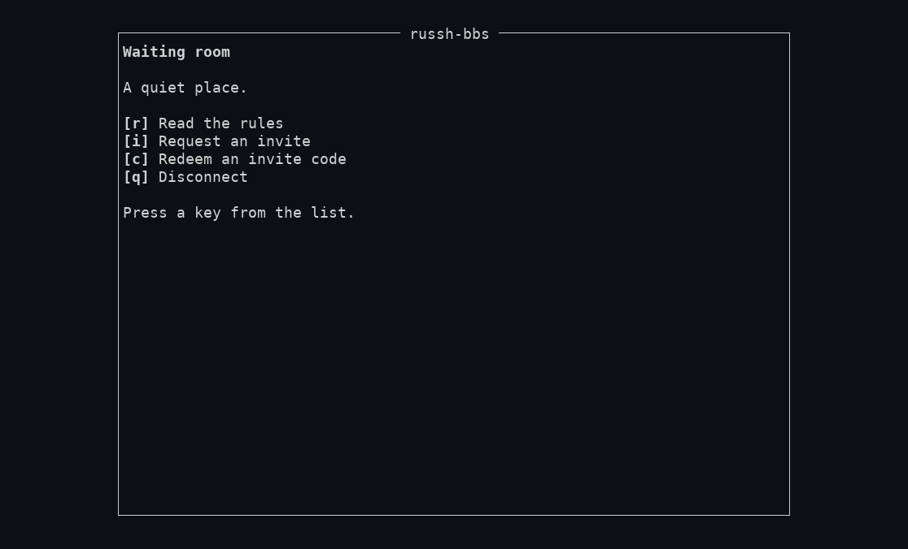

# 4. People: registration, roles, moderation, telnet

## Registration modes

`registration_mode` ([config](03-config.md#the-tour-in-the-order-a-sysop-needs-it)) is the sysop's one switch for how strangers get in. **`invite` is the default (D2)**; `apply` and `open` add a path and change nothing else. The waiting room reads the mode for every connection, so a change in the database applies at once (a config or environment change applies at the next start).

| Mode | A stranger's waiting room offers | What they get |
|---|---|---|
| `invite` | Read the rules, **Request an invite**, **Redeem an invite code** | A request that waits in your queue, or an account from a code a member gave them |
| `apply` | Read the rules, **Apply for membership** | An application in your queue. The account does not exist until you approve it. Nobody is notified: they connect again later to find out |
| `open` | Read the rules, **Create an account** | An **active** account at once, within per-address and per-key limits and a daily cap (default 25 a UTC day). At the cap the stranger sees the `apply` path until 00:00 UTC |

Walked with a real client in each mode: the key-less waiting room showed `[r] Read the rules` + `[i]`/`[c]` (invite), `[r]` + `[a] Apply for membership` (apply) and `[r]` + `[n] Create an account` (open). **In every mode a stranger sees no member list, no board list and no numbers**, only the board's banner and rules. Switching modes never changes existing accounts or requests already waiting.

Every join, in every mode, includes **choosing a password** (12 to 128 characters). A key the person connected with is bound to the account too, so they can sign in by key afterwards; one who connected without a key has only the password.

**The invite path in practice** (walked): a member opens **Invites, Create an invite** and gets a code once (shown on screen, valid seven days, single use; the board keeps only a hash, so a lost code means a new one). Quotas follow the role ([config.md](../../config.md#resource-limits-m2-h): `member` 2 a month, `trusted` 5, `moderator` 10, `cosysop` 50, `sysop` unlimited). The invitee redeems it under `ssh new@host` → **Redeem an invite code**: code, handle, password twice, and they are in. **Invites, Invite tree** shows who invited whom.

**The queue.** **Sysop tools, Invite requests** lists waiting requests oldest first (handle, how long ago, how many members vouched for them, the first line of their message). `a` approves (creates the account and binds the key that asked), `d` denies (deletes the request and turns that key away for 24 hours), `v` vouches. Requests expire after 14 days. Vouching is a statement for you to weigh; it never approves anything ([queue.md](../../queue.md)). **Not built:** notifying an applicant.

## Roles and ranks

Access is **additive**: a member has the permissions of the roles they hold, nothing is ever denied by a deny list. Roles have a rank; staff can act only on people **strictly below** their own rank (D69).

| Role | Rank | In short |
|---|---|---|
| `waiting` | 0 | A stranger: the waiting room only |
| `member` | 10 | Read, post, mail, chat, community, doors, invites (small quota) |
| `trusted` | 20 | `member` plus making polls, vouching, seeing the invite tree |
| `moderator` | 30 | `trusted` plus every `*.moderate` (remove posts, wall lines, polls) and `members.deny` |
| `cosysop` | 40 | `moderator` plus the `*.manage` permissions, approving members, recovery codes, edit others' profiles |
| `sysop` | 100 | Everything |

Full permission lists: [access.md](../../access.md#default-roles). Per-role limits (minutes and calls a day, sessions, posts an hour, mail a day, invites a month) are in [config.md](../../config.md#resource-limits-m2-h).

> **Not built (M5): there is no way to give someone a role from the board.** The services exist and are tested (`create_role`, `grant_role`, …, [access.md](../../access.md)), but no screen calls them. Every account the board makes today is a `member` (the founder is the `sysop`). So the `trusted`, `moderator` and `cosysop` rows describe what those roles *do* once the M5 console can assign them; until then the practical staff are the sysop. Tracked as [FIX-DOC1-2](../../coordination.md).

## Moderation as it stands

What a sysop can actually do today, all from the menus and all audited where it changes something:

| To | Do |
|---|---|
| Remove a forum post | Open it in the reader, `x`, then `y` |
| Close, restrict or open a board; let a member into a restricted one | Forums: `n` new board; in a board's thread list, `a` adds a member to a restricted board; `p` makes a board public for RSS out |
| Remove a one-liner or wall line | Community, the list, `d`, the number |
| Close or remove a poll | Community, Polls, open the poll: `c` closes it (creator or staff), `x` removes it (staff) |
| Open or close a chat room | Chat, `n` / `x` |
| Admit, turn away, vouch for requests | Sysop tools, Invite requests |
| Help someone who lost their key and password | Sysop tools, **Recovery code** (below) |
| Add or remove an RSS feed board | Forums, `f` (needs `feeds.manage`; feeds are off until `feeds.enabled`) |

**Recovery codes.** Confirm who is asking **outside the board** (a call, a trusted channel; the board has nothing to check them against, and the screen says so). Sysop tools, **Recovery code**, type their handle: the screen shows a 16-character code once (valid 24 hours; replaced by a newer one). Give it to them; they connect with `ssh new@host`, choose **Recovery code**, enter it and a new password twice. Walked: the code worked once, the member was signed in, **their other open session was closed with "Your sign-in was revoked. Please sign in again."**. Recovery does *not* remove their older keys (the board cannot know which was lost); they are told at their next sign-in and should remove any key they do not recognise. There is no code for a sysop: a second sysop is the way ([accounts.md](../../accounts.md#staff-recovery-code)).

**Not built (M5), so you cannot yet:** suspend or ban an account, change a role, see the audit log, read mail reports (a recipient can send one; staff have no screen for them), change the registration mode or caps from a screen, set per-member limits, or use the chat moderation tools. The audit log is written for every change above (it is append-only and has a database trigger to prove it) but there is no screen over it. The **door staff tools** (bar a player, reset a player, end a season) exist as tested services with **no screen**, see [06](06-doors-and-storage.md).

## Telnet and its limits

Telnet is **off by default and binds no port**. Turn it on only if you want classic reach and accept that it is unencrypted. Two switches (`telnet.enabled`, then `telnet.allow_login`) and the board is in **low-security mode**: a loud warning in the log and a marker on every staff screen.

Walked with a real `telnet` client (inetutils 2.4):

- The connect banner says `THIS CONNECTION IS NOT ENCRYPTED. Anyone on the network between you and this board can read what you type, your password included. Use ssh if you can.` and `New here? Type new as your login name to join.`; the last row of **every** screen is the reserved `UNENCRYPTED anyone on the network can read this session` marker (in the Unicode tier a `⟦⊗⟧` marker) that no theme, layout or member can hide.
- A visitor who types `new` at `login:` reaches the **same waiting room as ssh**, in whatever mode you set, and joins as a **password account** with no key. (There is no founder claim and no SFTP over telnet.) A password typed over telnet crosses the network in the clear: tell members not to reuse one. Only ASCII passwords can be typed.
- **Staff powers are dropped over telnet (D94).** Roles of rank 40 and above (`cosysop`, `sysop`) are removed for the session, so the sysop who signs in over telnet is an ordinary member. Walked: the founder's telnet main menu had **no Sysop tools**; the same account over ssh did.
- Everything else a member does works over telnet: mail, chat, forums, invites, doors, the password page. Telnet shares the per-member session limit with ssh.
- Bind it to a private address (`telnet.listen`) or firewall it if you can; there is no TLS.

**What was walked and what was read.** Walked in this guide's run: the three registration-mode waiting rooms, an invite made and redeemed, a forum board made, the recovery-code flow, the telnet sign-in and its missing Sysop tools. The queue keys, moderation keys, rank rules and quotas are quoted from [queue.md](../../queue.md), [access.md](../../access.md) and [community.md](../../community.md), whose own QA walks are linked there; they were not re-walked.

Next: [look and feel](05-look.md).
