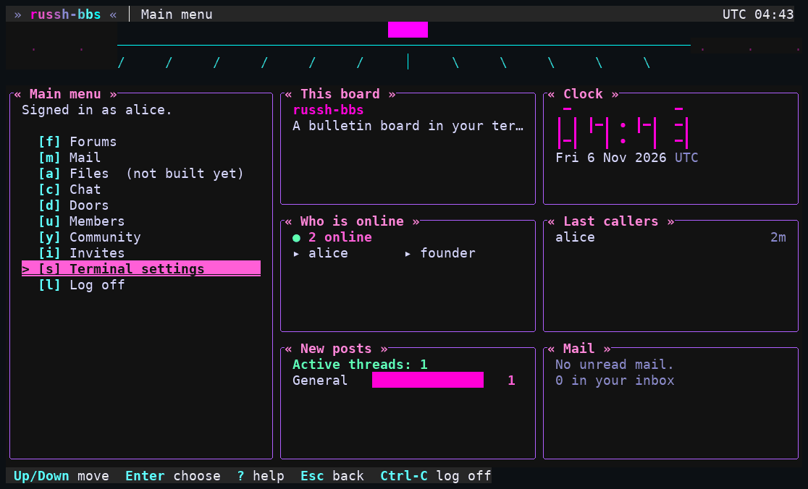
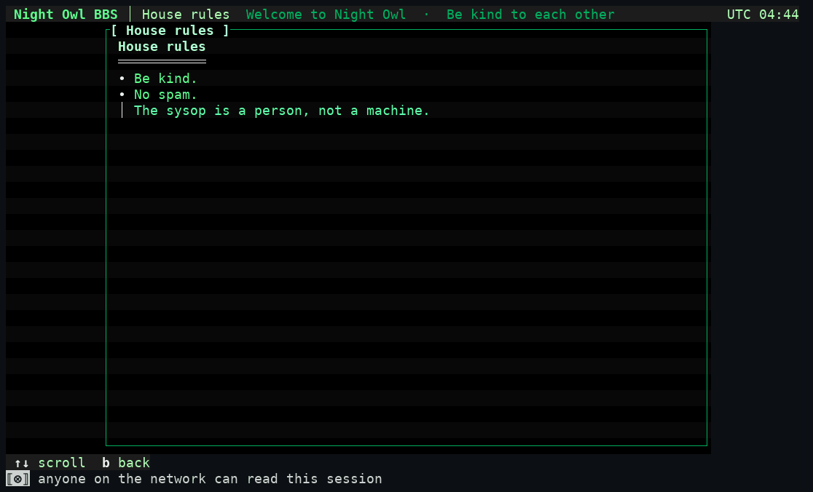
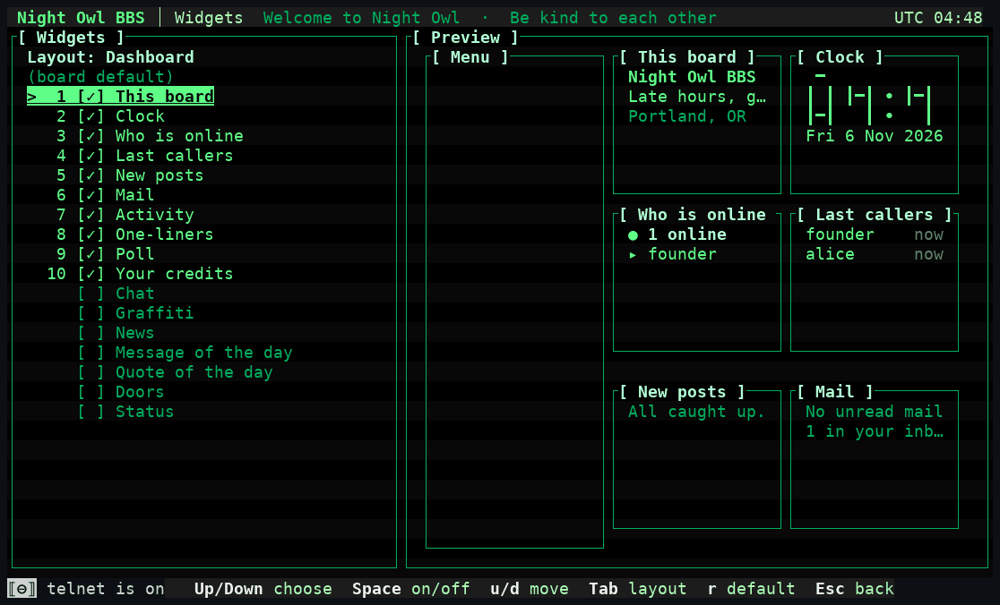

# 5. Look and feel

Everything here changes how the board *looks and is laid out*. None of it can change who may do what: the menu tree and every permission check stay in the server's core (D54), and security cues are fixed (below).



*The `dashboard` layout in the `neon` style, run with the config from [03-config.md](03-config.md).*

## Two separate choices: style and layout

A **style** is how it looks (colours, borders, title treatment, banner art, backdrop). A **layout** is how the panes are arranged. Any style works with any layout, and a member's own choices narrow what the board allows (see the [member guide](../member/02-terminal.md)).

**Six styles ship**, plus the older colour-only themes: `phosphor` (green CRT), `neon` (synthwave), `paper` (calm and light, no motion), `amber`, `deepspace` and `ansi` (sixteen named colours only, like a 1994 board); also `default`, `green` and `contrast`. **Seven layouts:** `classic` (hotkey menu in a box), `lightbar` (same with a cursor), `compact` (one column, no box), `dashboard` (menu plus a grid of widgets), `wide` (navigation, content and a right rail), `focus` and `split` (menu beside a second pane). A layout that needs more room than the terminal has falls back and says so on screen. ([ui.md](../../ui.md#styles-layouts-and-board-identity-ui-2-d117) has the geometry.)

## Board identity: the `[board]` section

| Key | Sets |
|---|---|
| `board.name` | The name in the header bar, box titles and the login banner (1 to 40 characters) |
| `board.tagline`, `board.location`, `board.since` | The identity panel of the dashboard, wide and split layouts |
| `board.accent` | Replaces the style's accent colour: `#rrggbb`, a 0 to 255 index or one of sixteen names |
| `board.style`, `board.layout` | What members who never chose get |
| `board.styles`, `board.layouts` | Comma lists of what members **may** pick. **One entry locks it for everyone**, whatever they stored |
| `board.motion` | `false` turns every effect, the blinking cursor and the ticker's scrolling off board-wide |
| `board.art` | `false` ignores all banner art and draws the name in large letters |
| `board.quotes`, `board.ticker` | The logoff quotes (`|`-separated, up to 32) and the live line in the header bar (up to 8 lines of 80 characters; it scrolls one cell a second, still with motion off) |
| `board.ticker_feeds` | Also show the newest headlines of feed boards each member may read |

Board text is **refused, not altered**, if the shared sanitizer would change it (control or invisible characters, the reserved marker glyphs) **or if it says the board is private, secure or encrypted**. Run for this guide: `RUSSH_BBS_BOARD_NAME="Totally Private Vault"` stops the boot with `invalid value for board.name … must not say the board is private, secure or encrypted: the server can read everything except PGP-encrypted mail and files members encrypt themselves`. A style locked with `RUSSH_BBS_BOARD_STYLES=neon` booted normally. All keys: [config.md](../../config.md#board-ui-2).

## Security cues are not themeable

The status row's left cell is the **marker cell**: `UNENCRYPTED` over telnet and the low-security marker on staff screens while telnet is on. It is drawn by chrome code only, in a reserved style (bold plus reverse), and **no style, layout, art, page, widget or member setting can hide, move or restyle it**; content cannot produce the reserved style or the exact marker glyphs (lookalike characters can still be typed, which is why the style and the screen position are what you trust, [threat-model.md](../../threat-model.md)). There is no palette role for a marker and no way to name one in a theme file.

## Theme files, packs, and art

The data directory (beside the host key) is where the board looks for your additions. Everything is data: nothing is executed, fetched or interpreted as anything but text, and a bad file is **skipped with a logged reason and never stops the boot**.

| Path | What |
|---|---|
| `themes/*.toml` | A style: 24 colour roles, a skin (border sets, title treatment, header decoration, backdrop, motion ceiling). At most 32 files of 32 KiB. A theme whose text cannot be read against its own backgrounds is refused with the role and the contrast ratio named |
| `art/<slot>.ans`, `art/<style>.<slot>.ans`, `art/*.art.toml` | Banner and header pictures. Slots are `login`, `menu`, `area` and `logoff`. A CP437 `.ans` parser turns the picture into plain cells (it never passes an escape sequence through); `.art.toml` is the board's own text format with an optional ASCII form. At most 64 files; size and symbolic-link rules apply |
| `packs/*.pack.toml` | One file that carries a style **and** its art, for sharing |
| `menus.toml`, `pages/<id>.toml` | Menus and pages, below |

**To make your own style, start from a shipped one.** Sysop tools, **Theme packs** (`p`; needs `themes.manage`) lists the installed styles and any pack files. Walked: move to `phosphor`, `e`, and the screen said `Exported phosphor to packs/phosphor.pack.toml.`, a 2.8 KB file appeared in `packs/`. Edit it, drop it back (or someone else's pack) into `packs/`, and press `i` on it: the whole pack is validated first (each piece through the same loader that reads the same file from disk), then installed into `themes/` and `art/` without overwriting anything. Imports **load at restart**; there is no hot reload for themes. **Theme preview** (Sysop tools, `t`) shows a sample screen in any style, and lists art files that were refused.

The bundled themes are plain TOML in [`crates/server/src/ui/themes/`](../../../crates/server/src/ui/themes/) and are the best reference for the file format ([ui.md](../../ui.md#board-art-ui-3-d123) documents the schema and the `.art.toml` format).

## Menus and pages

`menus.toml` can **reorder, rename, re-key, hide and group** the built-in menu items and add links to **pages** you write. It **cannot add an action** or bypass a permission: a moved item keeps the permission of the menu it came from, so a file can only narrow who reaches something. This is the file that was run for this guide:

```toml
# menus.toml, beside the host key
version = 1

[[menu]]
id = "main"                  # built-in menus: main, sysop, invites, members, community

  [[menu.item]]
  target = "page:rules"      # a page you wrote
  key = "r"
  label = "House rules"
```

```toml
# pages/rules.toml
version = 1
title = "House rules"        # up to 32 characters
text = """
# House rules
- Be kind.
- No spam.
> The sysop is a person, not a machine.
"""
```



*The page above, as a telnet member sees it: headings, bullets and quotes in the board's colours. Page text goes through the sanitizer like any content.*

Items you do not list keep their place at the end with their default key; a key clash is a refusal that names the menu and key, so a later release cannot silently change your menu. A built-in item is hidden with `hidden = true`; hiding `main.sysop` removes the submenu. Caps: 32 KiB, 600 lines, 16 pages, 24 items per menu, 8 groups, nesting depth 4.

A **bad file is refused whole, logged with one reason, and the built-in menu stays; the board still boots.** Run: a `menus.toml` pointing at a page that does not exist logged `menus.toml refused; the built-in menu stays reason=page nope: no file pages/<id>.toml`. Reload without a restart from **Sysop tools, Menus and pages** (`m`; `l` reloads; `r` picks a role and previews the menu *that role* would see; `t` lists the pages). Sessions already signed in keep their menu; new ones get the new one. The preview screen after the reload showed `Using menus.toml` and `[r] House rules *` (the star marks an item your file added). Schema: [ui.md](../../ui.md#sysop-menus-and-pages-ui-6-d131).

## Widgets and locks

A **widget** is a small live panel the pane layouts place in their cells (dashboard grid, wide right rail, split second pane, the focus pop-over). They are built in: **identity, clock, online, callers, new posts, mail, chat, activity, credits, one-liners, wall, poll, news, message of the day, quote of the day, doors, status.** A widget a member cannot reach (for example `status` without `sessions.view`, `mail` without `mail.read`) is never offered to them and never fetched, whatever you configure.



| Key | Does |
|---|---|
| `widgets.hidden` | Widgets that do not exist on this board |
| `widgets.on` | Widgets every member sees; they can move one but not switch it off |
| `widgets.off` | Widgets nobody can switch on (shown as "locked off") |
| `widgets.dashboard`, `.wide`, `.focus`, `.split` | The default widgets and order for a member who never chose, per layout (at most 12) |
| `widgets.motd`, `widgets.quotes` | Your own words for two widgets (240 characters; up to 64 quotes). Empty collapses the widget |

An unknown id, one widget named twice in a list, or one in two of `hidden`/`on`/`off` stops the boot naming the key. The `classic`, `lightbar` and `compact` layouts draw no widgets. [ui.md](../../ui.md#widgets-ui-10), [config.md](../../config.md#widgets-ui-10).

Next: [doors and the blob store](06-doors-and-storage.md).
