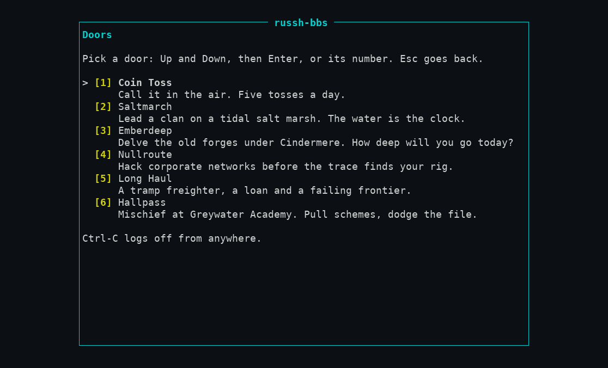

# 6. Doors and the blob store

## Doors

A *door* is a game that runs inside the board. Each game is its own crate on a shared door framework: a pure rules engine (state plus an action gives a new state), a seeded random source, the board's clock, and saves written only through the framework. **A door has no file system or network access** and cannot see the screen or the transport; the framework draws what the door draws into its own off-screen buffer and **cleans every cell** (sanitizer, no reserved marker style, no escape sequences, clipped to the door's area, never over the marker cell).

All six doors are compiled into the one binary and listed under **Doors** on the main menu. All six were opened in this guide's run:

| # | Door | What it is | Status ([doors/README.md](../../doors/README.md)) |
|---|---|---|---|
| 1 | Coin toss | The example door: call heads or tails, five tosses a day, a shared tally | Implemented; keys `h` `t` `n` `q` |
| 2 | Saltmarch | Clan strategy on a tidal marsh, daily turns | Engine, expeditions, combat, screens and a social layer implemented; quests and factions **planned** |
| 3 | Emberdeep | Fantasy delving RPG: one hero, one town, a dungeon that deepens each season | Engine, town and crafting, and screens implemented |
| 4 | Nullroute | Hacking and heists against generated networks | Engine, countermeasures, coding and screens implemented; crews and arcs **planned** |
| 5 | Long Haul | Space trade and exploration | Engine, crew, events, combat, jobs and screens implemented |
| 6 | Hallpass | School mischief at Greywater Academy | Engine, classes, screens and a social layer implemented; content is short of the design budget (the doc says so) |

Each game has more than one ending and a shared world: some outcomes change the game for every player until the season ends. Details of each game are in their documents under [doors/](../../doors/).

### What you control

- **Who can play:** the `doors.run` permission, held by every `member` and above. There is no per-door switch and **no way to hide one door**; `menus.toml` can hide the whole Doors item (`hidden = true` on `main.doors`) but not a single game ([05-look.md](05-look.md#menus-and-pages)). The Widgets screen's `doors` widget is off by default.
- **Daily ticks:** each game registers an hourly scheduler job at start (`door-saltmarch`, `door-emberdeep`, …; you can see them in the log: `job registered … interval_seconds=3600`). A tick is idempotent per day and catches up, with a cap, after downtime. On a first start each logs `door tick applied … days=1`.
- **Credits:** doors keep their own in-game currency. Paying board credits for results is designed as an opt-in that is off by default; **today there is no earning rule and no screen for the credits ledger**, so doors pay nothing outside the game ([features.md](../../features.md)).

### The staff tools

Three per-door staff actions exist in the server's core, rank-checked (D69: the target must be strictly below the staff member), audited, and tested:

| Action | Permission | Held by |
|---|---|---|
| Bar a player from a door, and lift the bar (the save is kept) | `doors.bar_player` | `moderator`, `cosysop`, `sysop` |
| Delete one player's save in one door | `doors.reset_player` | `cosysop`, `sysop` |
| Start a new season (adds one to the door's season number; the game decides what an older save means) | `doors.end_season` | `cosysop`, `sysop` |

> **Not built: there is no screen for any of them** ([access.md](../../access.md#permissions), [doors/README.md](../../doors/README.md)). They are services with tests, waiting for the M5 admin console. Until then a sysop cannot bar a player or reset a save from the board, and the guide will not pretend otherwise. Tracked as [FIX-DOC1-3](../../coordination.md).

### Door limits worth knowing

A door's text goes through the same sanitizer as everything a member types; names a player types pass the reserved-name rule. Doors behave the same over ssh and telnet (D94). Every game is designed to be playable at 80x24 in the ASCII icon tier, and has a plain-text "look around" view for screen readers (not tried with a screen reader here).

## The blob store

Everything a member uploads will live behind one object-store interface, `BlobStore` (D30), with two interchangeable backends, **local** (a directory) and **S3** (AWS or any compatible server: MinIO, R2, B2, and so on). The database, the host key, the config, themes and menus are *not* blobs and never go through it.

> **What this is worth today: almost nothing.** The store is built and tested, and the server builds it at start so a bad directory or bucket stops the boot, but **file areas, SFTP, uploads and the quarantine scan are not built** (M4-F2 and later). Nothing reads or writes the blob store yet. The main menu shows `[a] Files (not built yet)`. Set it up now only if you want the boot check; you can change backends later by copying objects.

| Setting | Meaning |
|---|---|
| `blobs.backend` | `local` (default) or `s3` |
| `blobs.dir` | Local only. Default is `blobs/` in the data directory; created with mode 0700 |
| `blobs.bucket` | S3 only, required. **The bucket must already exist**; the server checks it at start and refuses to boot if it cannot list it |
| `blobs.endpoint`, `blobs.region`, `blobs.path_style` | S3. `endpoint` unset means AWS. MinIO and most self-hosted servers need `path_style = true`. Plain `http://` works but warns at start |
| `blobs.ca_file` | S3. A PEM file that **replaces** the platform CA list for this connection only (private CA) |
| `blobs.max_object_bytes`, `blobs.multipart_threshold_bytes` | Size ceiling (default 256 MiB) and multipart part size (16 MiB) |

S3 credentials are **never** in the config file. Set `AWS_ACCESS_KEY_ID` and `AWS_SECRET_ACCESS_KEY` (and `AWS_SESSION_TOKEN`), or give the host an instance or container role, which is the right choice on AWS. Objects are stored as `<namespace>/<xx>/<id>` followed by a 56-byte trailer (SHA-256, size, time), the same bytes in both backends, so a board can move between a directory and a bucket by copying objects and changing one setting. Give the bucket a lifecycle rule that aborts incomplete multipart uploads after a day or two. Backups must cover the directory too (it will hold the only copy of uploaded files).

**Verified here:** the local backend (the data directory showed `blobs/` and `blobs/tmp/` after the first start; log line `blob store ready backend="local"`). **Not verified:** S3 of any kind, because none was reachable; the keys above are from [config.md](../../config.md#blobs-d30-m4-f1) and [deploy.md](../../deploy.md#running-with-an-s3-bucket), and the S3 test recipe (MinIO in a `russh-bbs-minio-*` container) is in [deploy.md](../../deploy.md#testing-the-s3-blob-backend).

Next: [running it](07-operate.md).
