# UI-9 walk: mouse, palette, toast, ticker

Real binary (`target/debug/russh-bbs-server`, scratch SQLite board, `[board]` name "Night Owl BBS" and `RUSSH_BBS_BOARD_TICKER` set through the environment) driven by the **real OpenSSH 9.6 client** and the **real `telnet` client** under a pty at 80x24 (`TERM=xterm-256color`, `COLORTERM=truecolor`), read through `pyte`. Mouse reports were written to the pty as an SGR-1006 terminal sends them. Founder claimed over ssh; the telnet session logged in with the founder's password.

What the walk asserted (and the scripts stop if it is false):
- ssh: the mouse is off until `[o]` in settings; the frame after it carries `ESC[?1000h ESC[?1006h`; a click on the "Terminal settings" row opens it; Ctrl-K opens the palette, typing narrows, Enter runs through the normal path; a click on the members row presses its digit and opens the profile; two wheel notches move the lightbar cursor two rows; on Ctrl-C the server sends `ESC[?1006l ESC[?1000l` **before** `ESC[?1049l`.
- telnet: the same mouse-on bytes, a click opens the row, Ctrl-K opens the palette, and the mouse is turned off before the alternate screen is left. The `UNENCRYPTED` marker stays on the transport's own last row.

Not walked: other terminal emulators, real mouse hardware (events were synthesized), Postgres-backed boards, the unread-mail toast, a forums table click (no boards exist on a fresh board; the table click is covered by `ui::table` and `ui::input` tests and the members table was clicked), the page-turning wheel in the reader.

| Screenshot | What it shows |
|---|---|
| 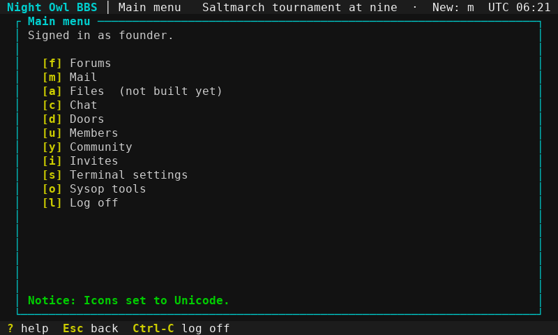 | Main menu, mouse off (the default): a header ticker, no toast |
|  | Settings: the member's mouse choice ([o]) |
| 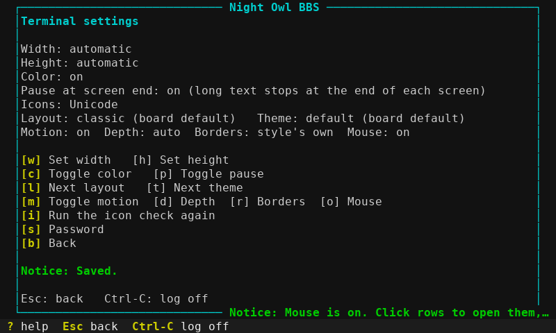 | [o] pressed: the client was told to report the mouse, and a toast says so |
| 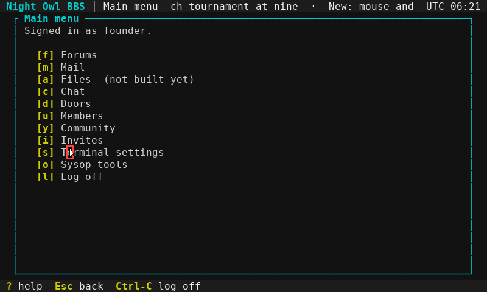 | Click target: the Terminal settings row |
| 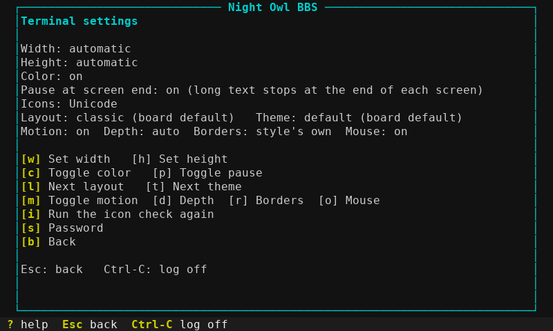 | The click opened the row, exactly as pressing [s] does |
| 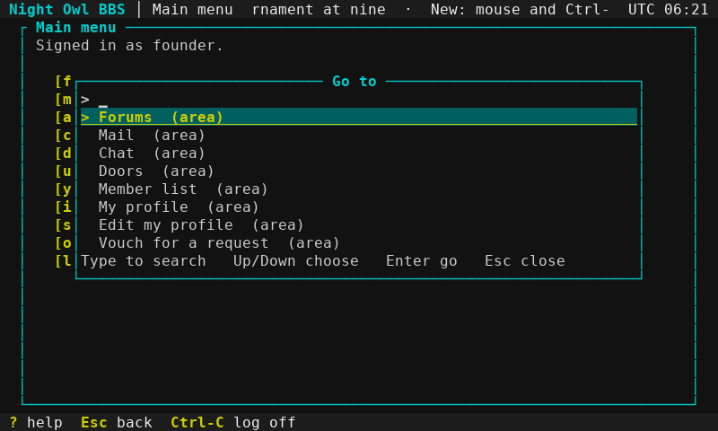 | Ctrl-K: the command palette over the menu (areas, settings pages, boards, doors the member may reach) |
| 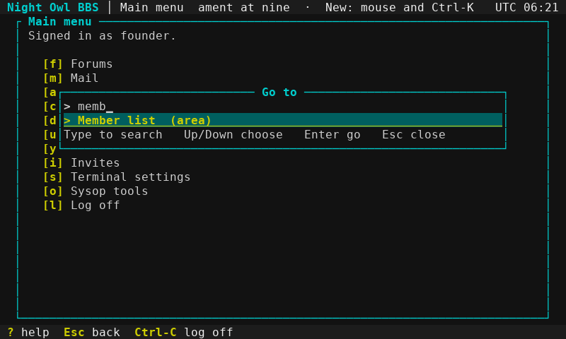 | Typing narrows it with a fuzzy match |
| 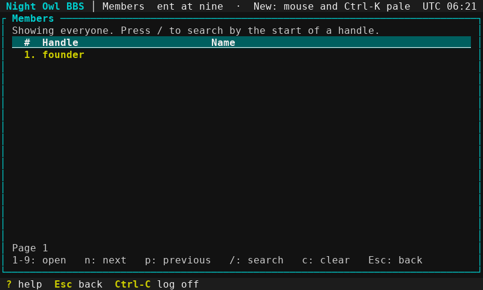 | Enter ran the choice through the normal path: the members menu |
| 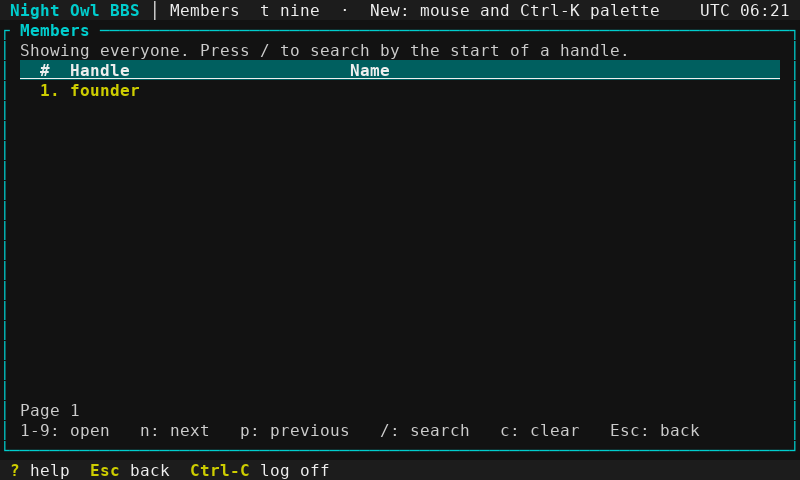 | The members table: numbered rows are picked by their digit, so a click presses the row digit |
| 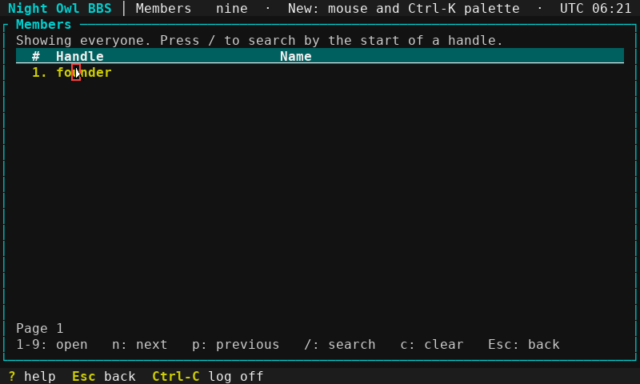 | Click target: the founder row |
| 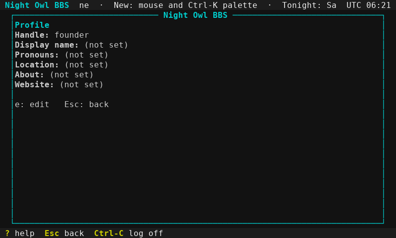 | The click pressed the row's digit: the profile opened, as typing 1 does |
| 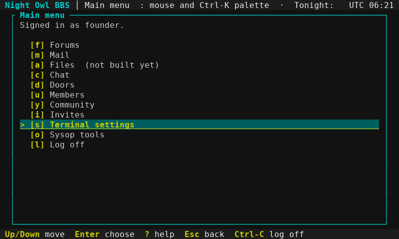 | Lightbar layout: the cursor is on Terminal settings |
| 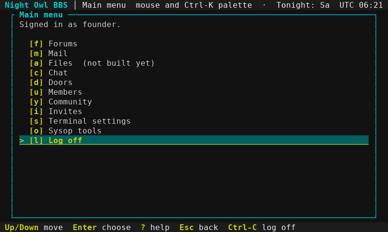 | Two wheel notches moved the cursor down two rows (to Log off), like the Down key |
| 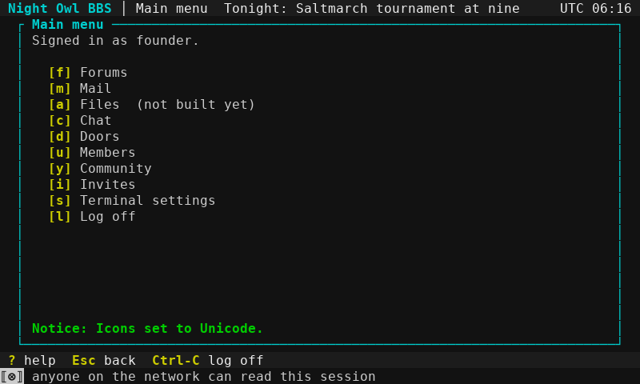 | Telnet: the main menu (UNENCRYPTED marker on the transport's own last row) |
| 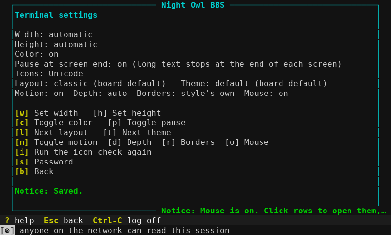 | Telnet: the mouse setting turned on; the client is told to report it |
| 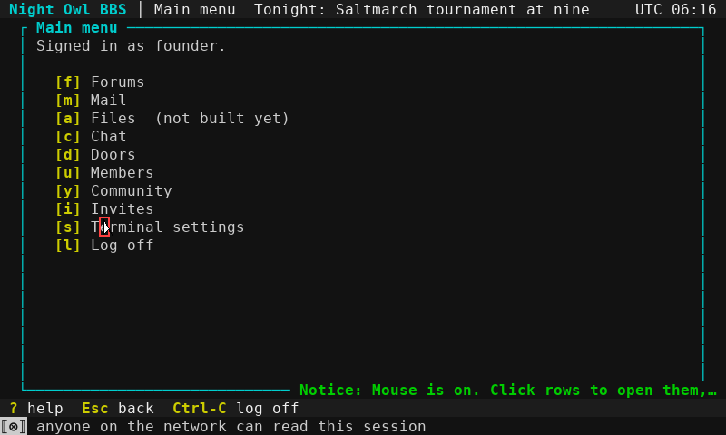 | Click target |
| 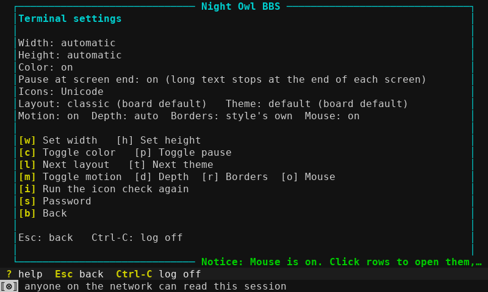 | Telnet: the click opened Terminal settings, the same as pressing [s] |
| 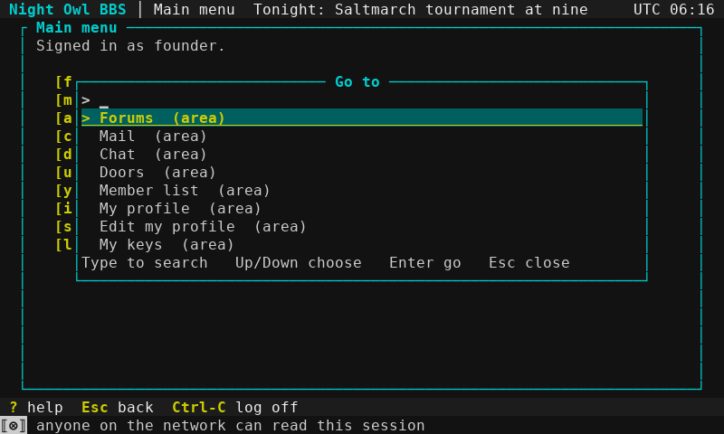 | Telnet: Ctrl-K opens the palette (only what this telnet session may reach) |
| 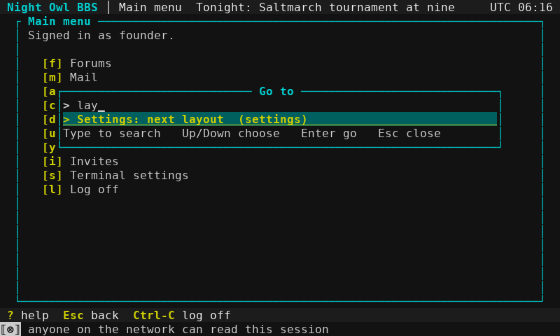 | Telnet: typed 'lay' |
