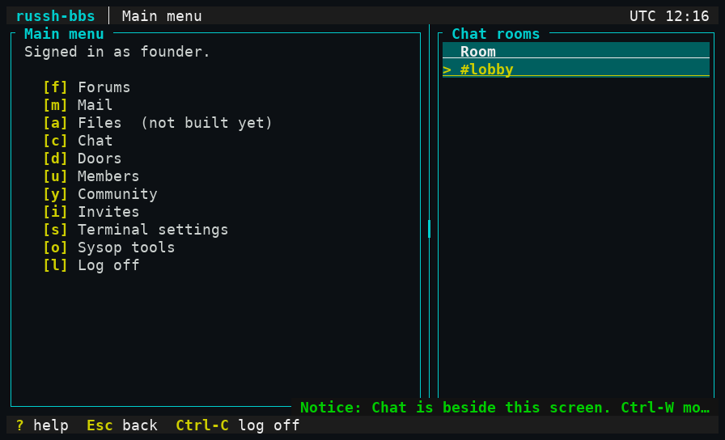
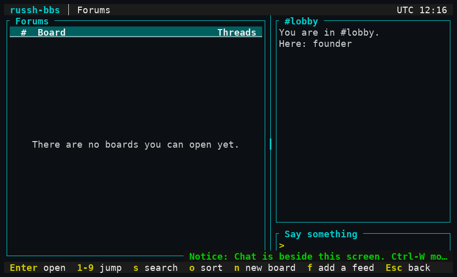
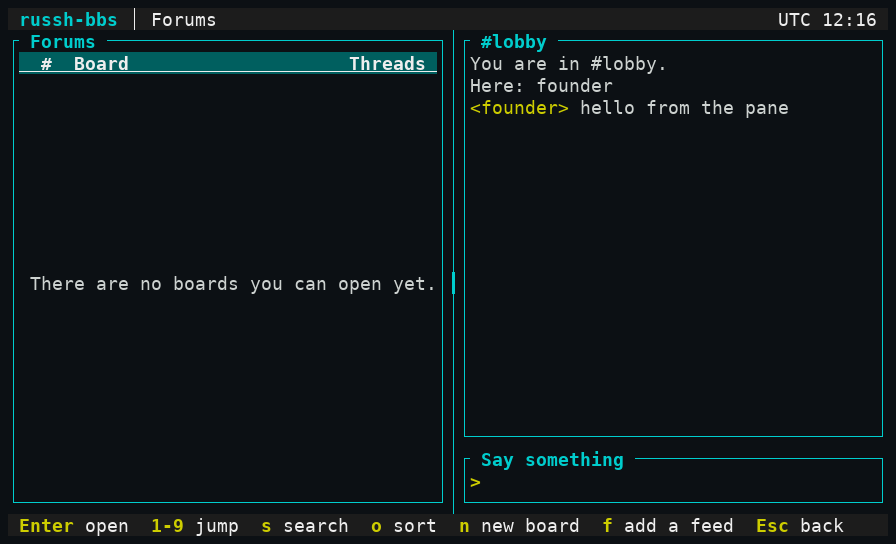
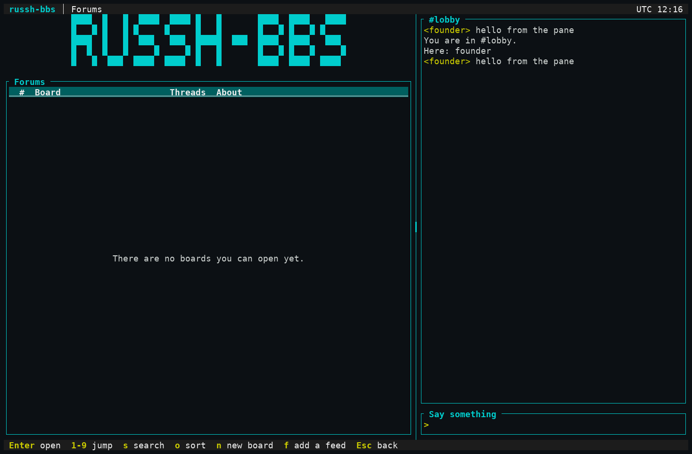
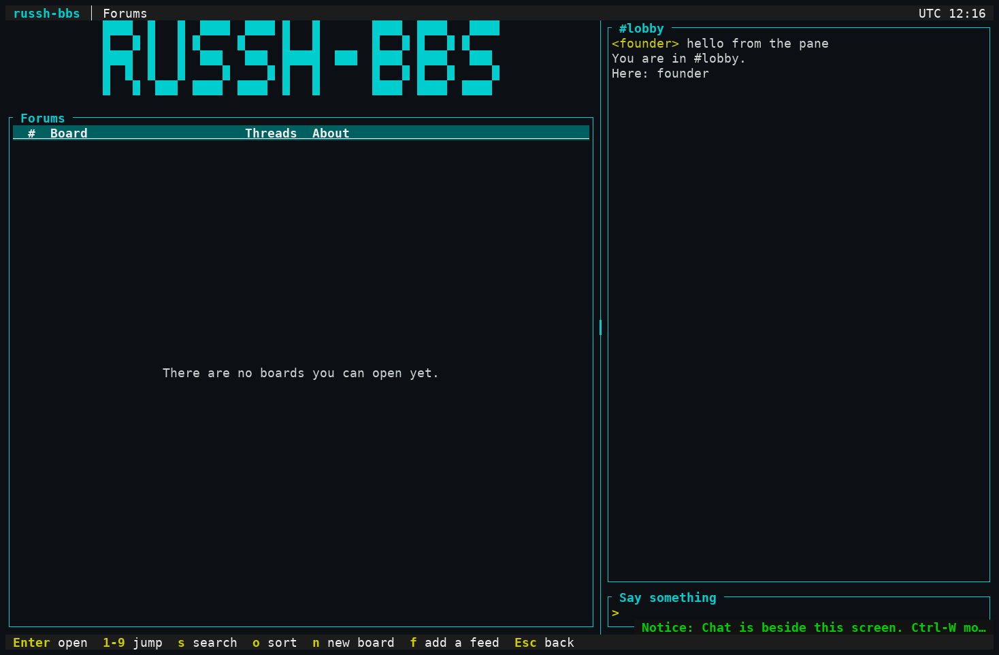
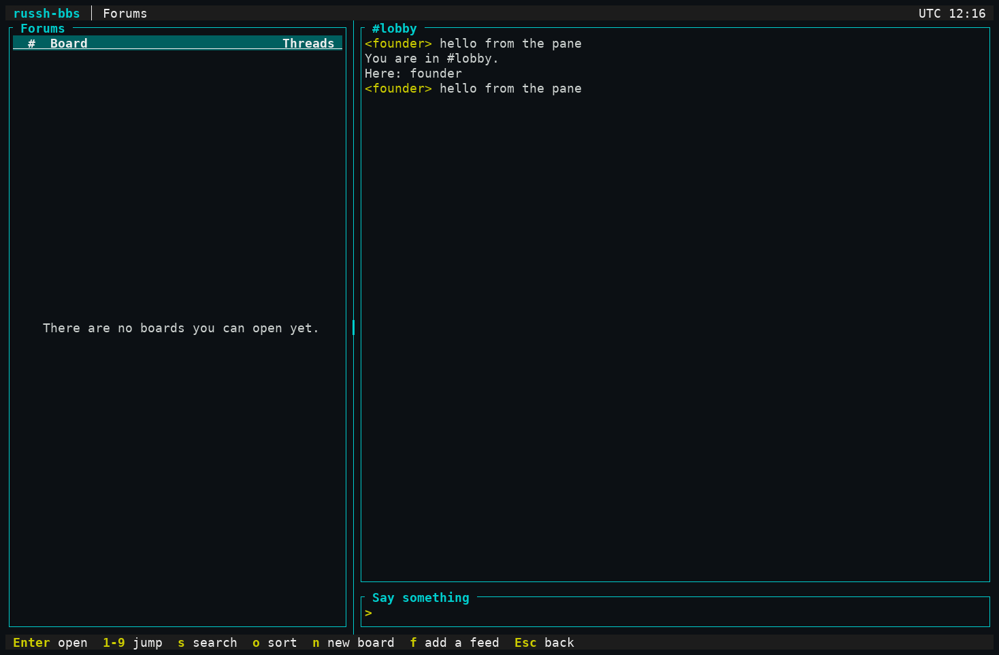
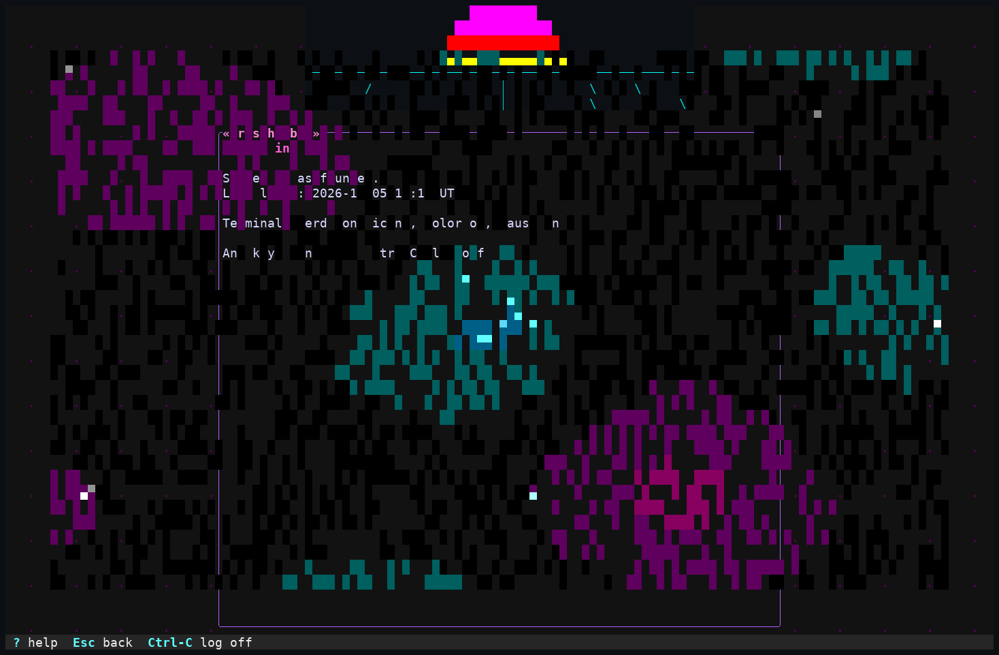
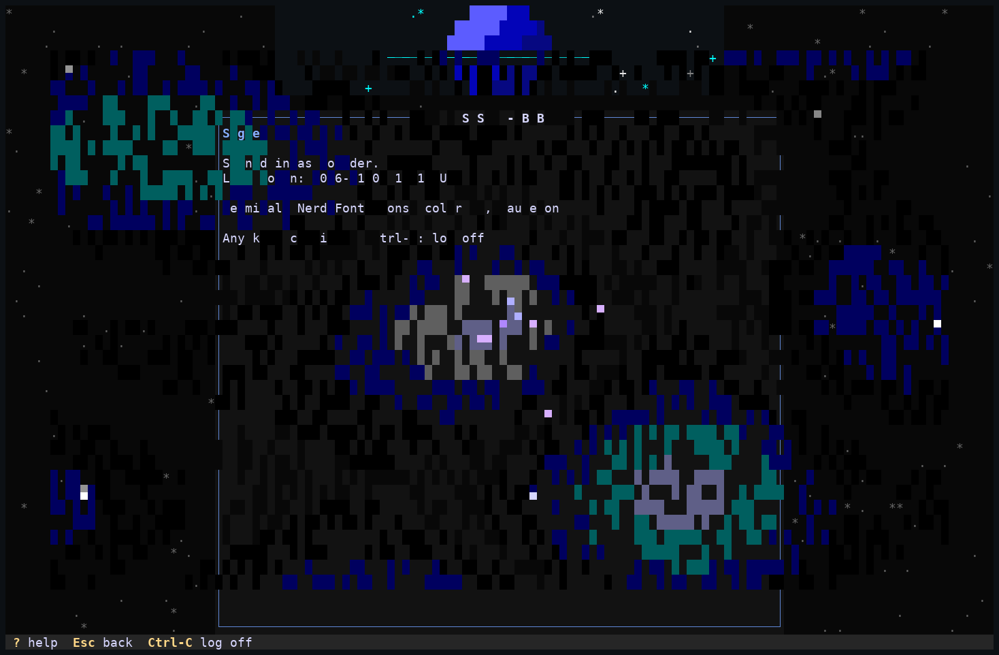

# UI-W walk: the dock, the divider and the banner intro over real ssh

Date: 2026-11-05. Branch `m35/wiring`. **What was run:** the real server binary (`target/debug/russh-bbs-server`, scratch SQLite board, founder claimed with `ssh claim@127.0.0.1`) driven by the **real OpenSSH 9.6 client** (`ssh -tt`, `TERM=xterm-256color`, `COLORTERM=truecolor`) in a pty of 80x24 and 132x43, read through `pyte`, pictures made by `tools/screenshots/shot.py`. Mouse reports were written to the pty as an SGR-1006 terminal sends them (press, motion with the button held, release). Script: [ui-w-screens/walk.py](ui-w-screens/walk.py) (`claim`, `capture`, `intro`).

What the walk asserted (the script stops if any is false), at both sizes:
- the mouse was turned on in settings and the client was asked for `?1002h` (button motion);
- `Ctrl-T` put the room list beside the menu and the status row stayed what it was; Enter joined `#lobby` from the pane;
- `Ctrl-W`, then `f`: the forums opened **with the chat still beside them**; `Ctrl-W` back, a line typed in the pane appeared in it;
- a drag of the divider (press on it, two motion reports, release) moved it left (80x24: column 47 to 40, which is the screen's 40-column floor; 132x43: 79 to 70); a second drag past the left edge stopped at the bound; `>` pressed six times moved it exactly six columns;
- `Esc` to the menu, `Ctrl-T`: the pane and its divider were gone and the status row was unchanged.

Intro: signed in with `RUSSH_BBS_BOARD_STYLE=neon` and `=deepspace` at 132x43 (truecolor): 13 and 14 distinct text frames, 46.7 KB and 53.6 KB sent over the first 3 s, stills at 0.45, 0.9, 1.4 and 3.0 s. The still at 0.9 s shows the Neon banner art being dissolved into the login screen.

Not walked: telnet, other terminals, a real mouse, the ASCII tier over ssh (covered by unit tests in 7 layouts x 2 sizes), a slow link with the banner intro, forums with boards in them (a fresh board has none), a second member typing into the pane (covered by `tests/chat.rs`, over a real russh client).

| Screenshot | What it shows |
|---|---|
|  | `Ctrl-T` at 80x24: the room list beside the menu |
|  | The forums beside the lobby |
|  | After dragging the divider |
|  | 132x43: a line said in the pane |
|  | 132x43: forums beside the chat |
|  | After six `>` presses |
|  | The Neon intro mid-dissolve |
|  | The Deep Space intro |

Seen in the pictures: a toast ("Chat is beside this screen...") overlays the bottom rows of the body for a few seconds, as toasts do; it is never over the status row.
