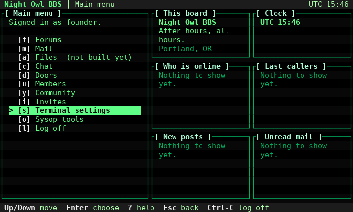
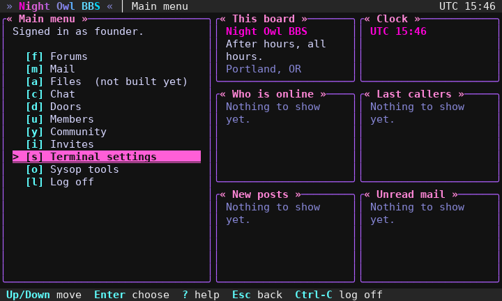
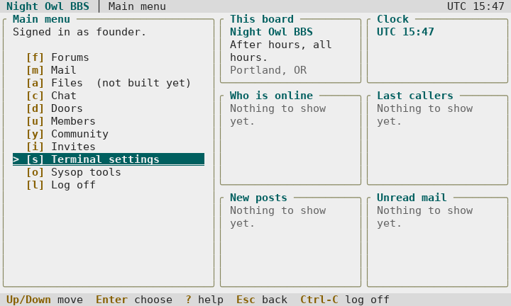
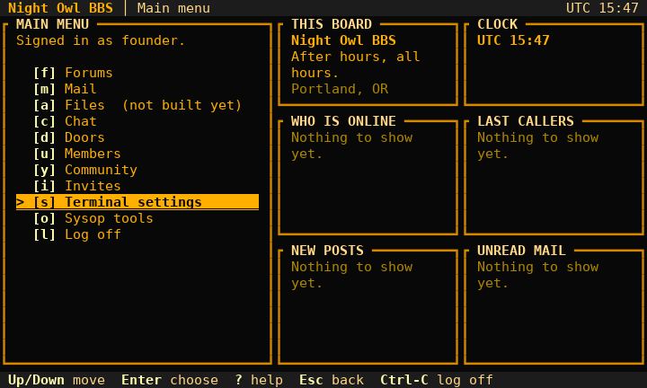
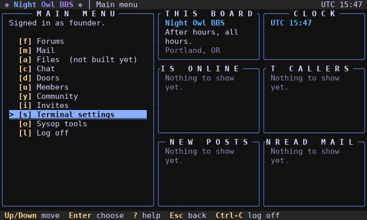
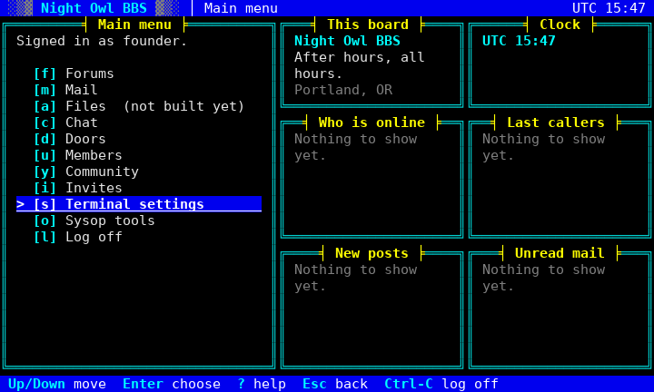

# UI-2 screenshots

Every image is the real server (`cargo run`, a scratch SQLite board with `[board]` set through environment variables: name "Night Owl BBS", tagline, location, since) driven by a real OpenSSH 9.6 client (`TERM=xterm-256color`, `COLORTERM=truecolor`). The style and layout were switched live on the settings screen with `t` and `l`, then the main menu was captured. The terminal is emulated with `pyte` and each cell is rendered to PNG in DejaVu Sans Mono, with truecolor, bold and underline. The ASCII-text capture of each screen sits beside it as `.txt`.

The layouts that need more room fall back (and say so): `wide` needs 110x22, so at 80x24 it shows the dashboard. That is why `*-wide-80x24` looks like `*-dashboard-80x24`; see the 132x43 images for wide.

Honest notes: the widget panels say "Nothing to show yet." until UI-10 fills them; the identity and clock panels are real. Nothing animates yet.

## At a glance (dashboard, 80x24)

**Phosphor**

**Neon Night**

**Paper**

**Amber Terminal**

**Deep Space**

**Classic ANSI**

## Phosphor (`phosphor`)

A green CRT: scanline shading, bracketed titles.

| Layout | 80x24 | 132x43 |
|---|---|---|
| classic | [png](styles/phosphor-classic-80x24.png) | [png](styles/phosphor-classic-132x43.png) |
| lightbar | [png](styles/phosphor-lightbar-80x24.png) | [png](styles/phosphor-lightbar-132x43.png) |
| compact | [png](styles/phosphor-compact-80x24.png) | [png](styles/phosphor-compact-132x43.png) |
| dashboard | [png](styles/phosphor-dashboard-80x24.png) | [png](styles/phosphor-dashboard-132x43.png) |
| wide | [png](styles/phosphor-wide-80x24.png) | [png](styles/phosphor-wide-132x43.png) |
| focus | [png](styles/phosphor-focus-80x24.png) | [png](styles/phosphor-focus-132x43.png) |
| split | [png](styles/phosphor-split-80x24.png) | [png](styles/phosphor-split-132x43.png) |

## Neon Night (`neon`)

Synthwave: magenta and cyan, gradient name, angle titles, faint grid.

| Layout | 80x24 | 132x43 |
|---|---|---|
| classic | [png](styles/neon-classic-80x24.png) | [png](styles/neon-classic-132x43.png) |
| lightbar | [png](styles/neon-lightbar-80x24.png) | [png](styles/neon-lightbar-132x43.png) |
| compact | [png](styles/neon-compact-80x24.png) | [png](styles/neon-compact-132x43.png) |
| dashboard | [png](styles/neon-dashboard-80x24.png) | [png](styles/neon-dashboard-132x43.png) |
| wide | [png](styles/neon-wide-80x24.png) | [png](styles/neon-wide-132x43.png) |
| focus | [png](styles/neon-focus-80x24.png) | [png](styles/neon-focus-132x43.png) |
| split | [png](styles/neon-split-80x24.png) | [png](styles/neon-split-132x43.png) |

## Paper (`paper`)

Ink on warm paper, thin rounded borders, no motion.

| Layout | 80x24 | 132x43 |
|---|---|---|
| classic | [png](styles/paper-classic-80x24.png) | [png](styles/paper-classic-132x43.png) |
| lightbar | [png](styles/paper-lightbar-80x24.png) | [png](styles/paper-lightbar-132x43.png) |
| compact | [png](styles/paper-compact-80x24.png) | [png](styles/paper-compact-132x43.png) |
| dashboard | [png](styles/paper-dashboard-80x24.png) | [png](styles/paper-dashboard-132x43.png) |
| wide | [png](styles/paper-wide-80x24.png) | [png](styles/paper-wide-132x43.png) |
| focus | [png](styles/paper-focus-80x24.png) | [png](styles/paper-focus-132x43.png) |
| split | [png](styles/paper-split-80x24.png) | [png](styles/paper-split-132x43.png) |

## Amber Terminal (`amber`)

Amber on black, thick borders, capital titles.

| Layout | 80x24 | 132x43 |
|---|---|---|
| classic | [png](styles/amber-classic-80x24.png) | [png](styles/amber-classic-132x43.png) |
| lightbar | [png](styles/amber-lightbar-80x24.png) | [png](styles/amber-lightbar-132x43.png) |
| compact | [png](styles/amber-compact-80x24.png) | [png](styles/amber-compact-132x43.png) |
| dashboard | [png](styles/amber-dashboard-80x24.png) | [png](styles/amber-dashboard-132x43.png) |
| wide | [png](styles/amber-wide-80x24.png) | [png](styles/amber-wide-132x43.png) |
| focus | [png](styles/amber-focus-80x24.png) | [png](styles/amber-focus-132x43.png) |
| split | [png](styles/amber-split-80x24.png) | [png](styles/amber-split-132x43.png) |

## Deep Space (`deepspace`)

Cold blues, starfield, spaced centred titles, gradient name.

| Layout | 80x24 | 132x43 |
|---|---|---|
| classic | [png](styles/deepspace-classic-80x24.png) | [png](styles/deepspace-classic-132x43.png) |
| lightbar | [png](styles/deepspace-lightbar-80x24.png) | [png](styles/deepspace-lightbar-132x43.png) |
| compact | [png](styles/deepspace-compact-80x24.png) | [png](styles/deepspace-compact-132x43.png) |
| dashboard | [png](styles/deepspace-dashboard-80x24.png) | [png](styles/deepspace-dashboard-132x43.png) |
| wide | [png](styles/deepspace-wide-80x24.png) | [png](styles/deepspace-wide-132x43.png) |
| focus | [png](styles/deepspace-focus-80x24.png) | [png](styles/deepspace-focus-132x43.png) |
| split | [png](styles/deepspace-split-80x24.png) | [png](styles/deepspace-split-132x43.png) |

## Classic ANSI (`ansi`)

Sixteen colours, double borders, rule titles, block fades.

| Layout | 80x24 | 132x43 |
|---|---|---|
| classic | [png](styles/ansi-classic-80x24.png) | [png](styles/ansi-classic-132x43.png) |
| lightbar | [png](styles/ansi-lightbar-80x24.png) | [png](styles/ansi-lightbar-132x43.png) |
| compact | [png](styles/ansi-compact-80x24.png) | [png](styles/ansi-compact-132x43.png) |
| dashboard | [png](styles/ansi-dashboard-80x24.png) | [png](styles/ansi-dashboard-132x43.png) |
| wide | [png](styles/ansi-wide-80x24.png) | [png](styles/ansi-wide-132x43.png) |
| focus | [png](styles/ansi-focus-80x24.png) | [png](styles/ansi-focus-132x43.png) |
| split | [png](styles/ansi-split-80x24.png) | [png](styles/ansi-split-132x43.png) |

